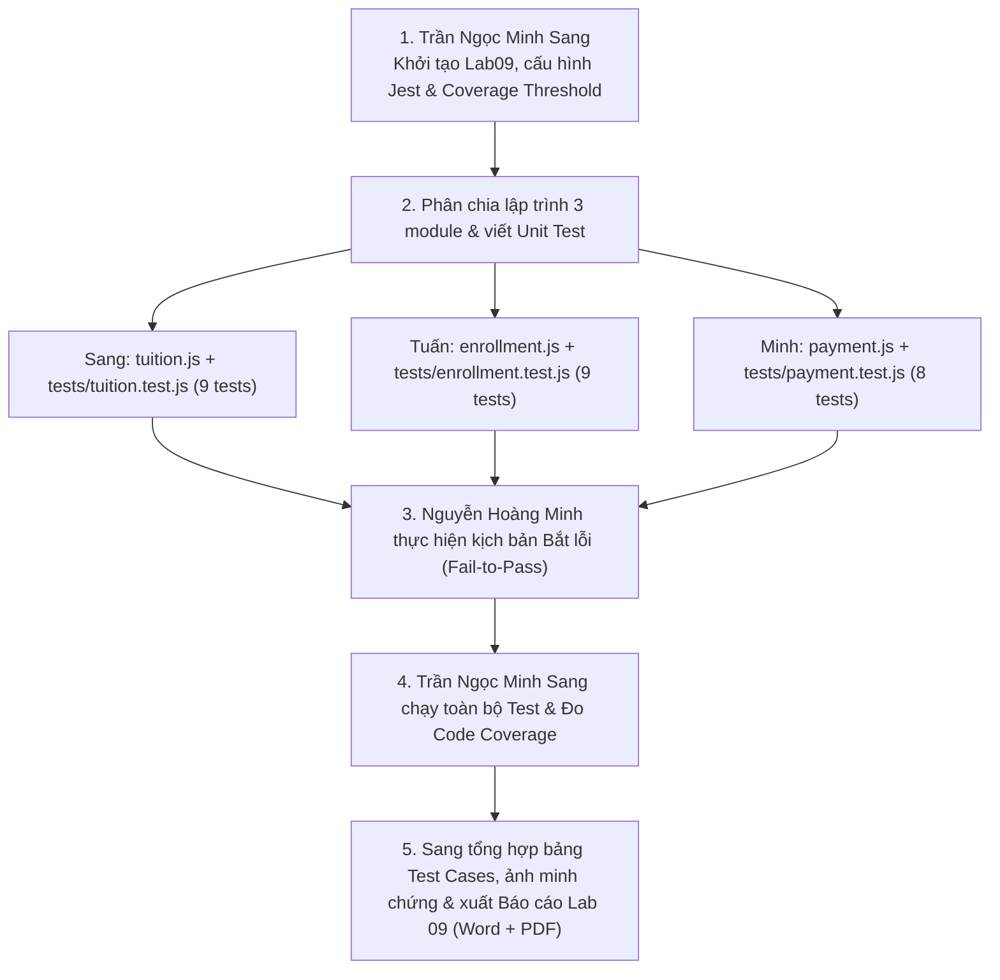

# KẾ HOẠCH & PHÂN CÔNG NHIỆM VỤ THỰC HÀNH LAB 09
## Chủ đề: Software Testing Fundamentals & Unit Testing
**Dự án:** Hệ thống Quản lý Học sinh THPT (*High School Student Management System*)  
**Repository:** https://github.com/tranngocminhsang232/High-School-Student-Management-System  
**Thư mục thực hành:** `Lab09/`  
**Framework kiểm thử:** `Jest` (Node.js)

---

## I. MỤC TIÊU CỐT LÕI CỦA BÀI LAB 09
1. **Hiểu và phân biệt các cấp độ kiểm thử phần mềm**:
   - **Unit Testing (Kiểm thử đơn vị)**: Kiểm tra các hàm nghiệp vụ độc lập, không phụ thuộc cơ sở dữ liệu hay giao diện.
   - **Integration Testing (Kiểm thử tích hợp)**: Kiểm tra sự phối hợp giữa nhiều thành phần (Service + Repository + Database).
   - **System Testing (Kiểm thử hệ thống)**: Kiểm tra toàn bộ luồng hoạt động từ giao diện đến máy chủ.
2. **Xây dựng 3 module nghiệp vụ cốt lõi & Thiết kế bộ Test Cases hoàn chỉnh**:
   - **Bài 1**: Module Tính học phí (`tuition.js` & `tests/tuition.test.js`) — $\ge 9$ test cases.
   - **Bài 2**: Module Đăng ký môn học (`enrollment.js` & `tests/enrollment.test.js`) — $\ge 9$ test cases.
   - **Bài 3**: Module Xác thực thanh toán (`payment.js` & `tests/payment.test.js`) — $\ge 8$ test cases.
3. **Đo độ bao phủ mã nguồn (Code Coverage)**:
   - Sử dụng Jest Coverage (`npm run test:coverage`), phân tích 4 chỉ số: **Statements**, **Branches**, **Functions**, **Lines**.
   - Thiết lập cấu hình ngưỡng tối thiểu **60% – 70%** (hướng đến 100% bao phủ toàn diện).
4. **Kịch bản Bắt lỗi thực tế (Fail-to-Pass Scenario - Yêu cầu bắt buộc của giảng viên)**:
   - Minh chứng một trường hợp cố tình tạo lỗi / phát hiện lỗi $\rightarrow$ Unit Test phát hiện và báo **FAIL**.
   - Phân tích nguyên nhân lỗi $\rightarrow$ sửa lỗi mã nguồn $\rightarrow$ chạy lại test suite báo **PASS**.
5. **Soạn thảo Báo cáo thực hành Lab 09**:
   - Bảng đặc tả Test Cases chi tiết (ID, Input, Expected Output, Actual Result, Status).
   - Đầy đủ ảnh chụp minh chứng terminal và giao diện HTML coverage (`lcov-report`).
   - Xuất file báo cáo chuẩn học thuật định dạng `.docx` và `.pdf`.

---

## II. BẢNG PHÂN CÔNG NHIỆM VỤ THÀNH VIÊN

| STT | Thành viên | MSSV | Vai trò chính | Nhiệm vụ chi tiết trong Lab 09 |
| :---: | :--- | :---: | :--- | :--- |
| **1** | **Trần Ngọc Minh Sang** | **52400155** | **Nhóm trưởng / Core Dev & Tổng hợp Báo cáo** | • Khởi tạo thư mục `Lab09/`, cấu hình môi trường Node.js & Jest (`package.json`, scripts, `coverageThreshold`).<br>• Lập trình module Tính học phí (`tuition.js`) và bộ 9 test cases (`tests/tuition.test.js`).<br>• Thực thi toàn bộ bộ kiểm thử, đo Code Coverage tổng thể (đạt 100%).<br>• Thu thập toàn bộ ảnh chụp minh chứng terminal & báo cáo HTML.<br>• **Trực tiếp biên soạn và hoàn thiện toàn bộ Báo cáo Lab 09 (Word & PDF).** |
| **2** | **Đặng Minh Tuấn** | **52400253** | **Module Lead (Đăng ký môn học)** | • Phụ trách module Đăng ký môn học (`enrollment.js`): Xây dựng hàm `validateEnrollment(student, courseSection)`.<br>• Thiết kế và lập trình bộ 9 test cases (`tests/enrollment.test.js`) bao phủ các ca: hợp lệ, trùng môn, đầy sĩ số, thiếu thông tin, ca biên còn 1 chỗ...<br>• Lập bảng đặc tả Test Cases chi tiết cho Bài 2 để đưa vào báo cáo. |
| **3** | **Nguyễn Hoàng Minh** | **52400081** | **Module Lead (Thanh toán & Kịch bản Bắt lỗi)** | • Phụ trách module Xác thực thanh toán (`payment.js`): Xây dựng hàm `validatePayment(amount)`.<br>• Thiết kế và lập trình bộ 8 test cases (`tests/payment.test.js`) bao phủ các ca: hợp lệ, biên nhỏ nhất, số 0, số âm, chuỗi, NaN, Infinity, null.<br>• **Thực hiện kịch bản bắt lỗi thực tế (Fail-to-Pass)**: Tạo lỗi logic $\rightarrow$ chụp ảnh test FAIL $\rightarrow$ phân tích lỗi $\rightarrow$ sửa mã nguồn $\rightarrow$ test PASS.<br>• Lập bảng đặc tả Test Cases Bài 3 và thuyết minh kịch bản bắt lỗi cho báo cáo. |

---

## III. QUY TRÌNH THỰC HIỆN CHI TIẾT



---

### BƯỚC 1: Khởi tạo môi trường dự án Lab09
* **Người thực hiện:** **Trần Ngọc Minh Sang**
* **Nội dung công việc:**
  1. Tạo cấu trúc thư mục `Lab09/` tại thư mục gốc repository:
     ```text
     Lab09/
     ├── tuition.js
     ├── enrollment.js
     ├── payment.js
     ├── tests/
     │   ├── tuition.test.js
     │   ├── enrollment.test.js
     │   └── payment.test.js
     └── package.json
     ```
  2. Khởi tạo `package.json` và cài đặt `jest`:
     ```bash
     cd Lab09
     npm init -y
     npm install --save-dev jest
     ```
  3. Cấu hình scripts và ngưỡng Coverage trong `package.json`:
     ```json
     {
       "scripts": {
         "test": "jest",
         "test:coverage": "jest --coverage"
       },
       "jest": {
         "collectCoverageFrom": [
           "tuition.js",
           "enrollment.js",
           "payment.js"
         ],
         "coverageThreshold": {
           "global": {
             "statements": 70,
             "branches": 60,
             "functions": 70,
             "lines": 70
           }
         }
       }
     }
     ```

---

### BƯỚC 2: Triển khai 3 Module & Bộ Test tương ứng

#### 1. Bài 1: Kiểm thử Tính học phí (`tuition.js` & `tests/tuition.test.js`)
* **Phụ trách:** **Trần Ngọc Minh Sang**
* **Hàm nghiệp vụ:** `calculateRemaining(totalAmount, paidAmount)`
* **Bộ 9 Test Cases:**
  * `TC01`: Tính tiền còn phải đóng bình thường (12.000.000 - 5.000.000 = 7.000.000)
  * `TC02`: Đã đóng đủ học phí (12.000.000 - 12.000.000 = 0)
  * `TC03`: Chưa đóng học phí nào (12.000.000 - 0 = 12.000.000)
  * `TC04`: Học phí bằng 0 (0 - 0 = 0)
  * `TC05`: Tổng học phí là số âm $\rightarrow$ Báo lỗi ngoại lệ
  * `TC06`: Số tiền đóng vượt tổng học phí $\rightarrow$ Báo lỗi ngoại lệ
  * `TC07`: Tổng học phí là `NaN` $\rightarrow$ Báo lỗi ngoại lệ
  * `TC08`: Tổng học phí là `Infinity` $\rightarrow$ Báo lỗi ngoại lệ
  * `TC09`: Dữ liệu truyền vào là chuỗi ký tự (`"abc"`) $\rightarrow$ Báo lỗi ngoại lệ

#### 2. Bài 2: Kiểm thử Đăng ký môn học (`enrollment.js` & `tests/enrollment.test.js`)
* **Phụ trách:** **Đặng Minh Tuấn**
* **Hàm nghiệp vụ:** `validateEnrollment(student, courseSection)`
* **Bộ 9 Test Cases:**
  * `EN01`: Sinh viên đủ điều kiện, lớp còn chỗ $\rightarrow$ Chấp nhận (`allowed: true`)
  * `EN02`: Sinh viên đăng ký trùng môn đã học $\rightarrow$ Từ chối (`allowed: false`)
  * `EN03`: Lớp học phần đã đủ sĩ số (`enrolledCount >= capacity`) $\rightarrow$ Từ chối
  * `EN04`: Sinh viên chưa đủ điều kiện (`eligible: false`) $\rightarrow$ Từ chối
  * `EN05`: Thiếu mã sinh viên hoặc chuỗi rỗng $\rightarrow$ Báo lỗi ngoại lệ
  * `EN06`: Sức chứa lớp là số âm $\rightarrow$ Báo lỗi ngoại lệ
  * `EN07`: Số lượng đã đăng ký vượt sức chứa $\rightarrow$ Báo lỗi ngoại lệ
  * `EN08`: Ca kiểm thử biên: Lớp còn đúng 1 chỗ cuối cùng $\rightarrow$ Chấp nhận
  * `EN09`: Danh sách môn đăng ký không phải kiểu mảng $\rightarrow$ Báo lỗi ngoại lệ

#### 3. Bài 3: Kiểm thử Xác thực thanh toán (`payment.js` & `tests/payment.test.js`)
* **Phụ trách:** **Nguyễn Hoàng Minh**
* **Hàm nghiệp vụ:** `validatePayment(amount)`
* **Bộ 8 Test Cases:**
  * `PAY01`: Chấp nhận số tiền hợp lệ (500.000 $\rightarrow$ `true`)
  * `PAY02`: Ca kiểm thử biên: Số tiền nhỏ nhất hợp lệ (1 $\rightarrow$ `true`)
  * `PAY03`: Từ chối số tiền bằng 0 ($0 \rightarrow$ `false`)
  * `PAY04`: Từ chối số tiền âm ($-100 \rightarrow$ `false`)
  * `PAY05`: Từ chối chuỗi ký tự (`"500000"` $\rightarrow$ `false`)
  * `PAY06`: Từ chối giá trị `NaN` $\rightarrow$ `false`
  * `PAY07`: Từ chối giá trị `Infinity` $\rightarrow$ `false`
  * `PAY08`: Từ chối giá trị `null` $\rightarrow$ `false`

---

### BƯỚC 3: Thực hiện Kịch bản Bắt lỗi thực tế (Fail-to-Pass Scenario)
* **Người thực hiện:** **Nguyễn Hoàng Minh**
* **Yêu cầu của giảng viên:** Chứng minh ít nhất một test thất bại khi mã nguồn có lỗi, phân tích nguyên nhân, sửa lỗi và chạy lại thành công.
* **Cách thực hiện:**
  1. Trong file `tuition.js`, cố tình sửa logic tính toán:
     ```javascript
     // Sửa từ phép trừ sang phép cộng:
     return totalAmount + paidAmount;
     ```
  2. Chạy lệnh: `npx jest tests/tuition.test.js`
  3. Kết quả: Test `TC01` bị **FAIL** (Expected: 7.000.000, Received: 17.000.000).
  4. **Chụp ảnh màn hình terminal báo lỗi FAIL màu đỏ.**
  5. Sửa lại code đúng: `return totalAmount - paidAmount;`
  6. Chạy lại test: Toàn bộ 9 test báo **PASS** màu xanh. Chụp ảnh màn hình làm minh chứng khắc phục lỗi.

---

### BƯỚC 4: Chạy đo độ bao phủ mã nguồn (Code Coverage)
* **Người thực hiện:** **Trần Ngọc Minh Sang**
* **Lệnh thực thi:**
  ```bash
  npm run test:coverage
  ```
* **Chỉ số kỳ vọng đạt được:**
  | File | % Stmts | % Branch | % Funcs | % Lines |
  | :--- | :---: | :---: | :---: | :---: |
  | `tuition.js` | 100% | 100% | 100% | 100% |
  | `enrollment.js` | 100% | 100% | 100% | 100% |
  | `payment.js` | 100% | 100% | 100% | 100% |
  | **All files** | **100%** | **100%** | **100%** | **100%** |
* Mở và chụp ảnh báo cáo HTML trực quan:
  ```powershell
  start .\coverage\lcov-report\index.html
  ```

---

### BƯỚC 5: Tổng hợp và Biên soạn Báo cáo Lab 09
* **Người thực hiện:** **Trần Ngọc Minh Sang**
* **Nội dung báo cáo:**
  1. Trang bìa chuẩn quy cách trường / khoa.
  2. Bảng phân công nhiệm vụ và tỷ lệ đóng góp của 3 thành viên (100%).
  3. Cơ sở lý thuyết: Định nghĩa & phân biệt Unit Test, Integration Test, System Test; các chỉ số Coverage.
  4. Bảng thiết kế 26 Test Cases chi tiết cho 3 module.
  5. Minh chứng ảnh chụp chạy test PASS của cả 3 bài.
  6. Minh chứng ảnh chụp báo cáo Code Coverage (Terminal & Giao diện Web HTML).
  7. Phân tích chi tiết kịch bản bắt lỗi Fail-to-Pass.
  8. Xuất file `Bao_Cao_Lab09.docx` và `Bao_Cao_Lab09.pdf`.
