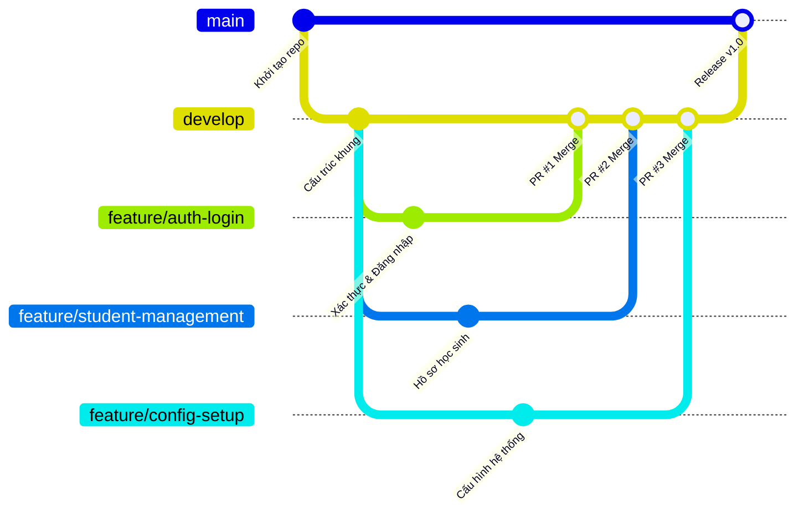

# High School Student Management System

## 1. Giới thiệu
Hệ thống Quản lý Học sinh THPT hỗ trợ số hóa và quản lý tập trung các quy trình: quản lý hồ sơ học sinh, phân lớp, phân công giáo viên, quản lý điểm số, chuyên cần, hạnh kiểm, báo cáo thống kê và thông báo dành cho phụ huynh.

## 2. Thành viên nhóm
| STT | Họ và tên | Vai trò / Nhiệm vụ phụ trách | Nhánh Git phụ trách |
| :---: | :--- | :--- | :--- |
| 1 | **Trần Ngọc Minh Sang** | Thiết kế CSDL & Xác thực | `develop`, `feature/auth-login` |
| 2 | **Đặng Minh Tuấn** | Tiếp nhận & Quản lý hồ sơ học sinh, Xếp lớp | `feature/student-management` |
| 3 | **Nguyễn Hoàng Minh** | Cấu hình hệ thống, môi trường & Khởi chạy ứng dụng | `feature/config-setup` |

## 3. Công nghệ sử dụng
- **Frontend**: HTML5, CSS3, JavaScript, React
- **Backend**: NodeJS, PHP, Spring Boot
- **Database**: MySQL / PostgreSQL

## 4. Cấu trúc dự án
```text
High-School-Student-Management-System/
├── README.md
├── .gitignore
├── docs/
│   ├── architecture.md          # Thiết kế kiến trúc hệ thống 3 lớp
│   ├── database-design.md       # Thiết kế cơ sở dữ liệu (ERD 14 bảng, Data Dictionary)
│   ├── ui-design.md             # Thiết kế giao diện (UI Specs & Wireframes)
│   ├── assets/                  # Sơ đồ kiến trúc, wireframe và ERD dạng SVG/PNG
│   ├── database/
│   │   ├── schema.sql           # Script khởi tạo cơ sở dữ liệu
│   │   └── constraints-and-rules.md
│   └── reference/
│       ├── Lab06.docx
│       ├── Lab06.pdf
│       └── ERD_14_bang_A4.pdf
├── backend/                     # Khung mã nguồn máy chủ
│   ├── pom.xml
│   └── src/
│       ├── main/java/com/highschool/
│       │   ├── Application.java
│       │   ├── config/
│       │   ├── controller/
│       │   │   ├── ClassAssignmentController.java
│       │   │   ├── ClassroomController.java
│       │   │   └── StudentController.java
│       │   ├── dto/
│       │   │   ├── CreateStudentRequest.java
│       │   │   └── UpdateStudentRequest.java
│       │   ├── model/
│       │   │   ├── Classroom.java
│       │   │   └── Student.java
│       │   ├── repository/
│       │   │   └── Studentrepository.java
│       │   └── service/
│       │       ├── ClassAssignmentService.java
│       │       └── StudentService.java
│       └── main/resources/
│           └── application.properties
└── frontend/                    # Khung mã nguồn giao diện
    ├── package.json
    └── src/
        ├── App.jsx
        ├── main.jsx
        ├── components/
        │   ├── ClassroomForm.jsx
        │   ├── ClassroomTable.jsx
        │   ├── StudentForm.jsx
        │   └── StudentTable.jsx
        ├── services/
        │   ├── api.js
        │   ├── classroomService.js
        │   └── studentService.js
        └── pages/
            ├── Login.jsx
            ├── StudentManagement.jsx
            ├── StudentDetail.jsx
            ├── ClassroomManagement.jsx
            └── ClassAssignment.jsx
```

## 5. Quy trình làm việc với Git Flow

Dự án áp dụng mô hình **Git Flow** nhằm chuẩn hóa quy trình phát triển và kiểm soát mã nguồn nhóm:



### 5.1. Quy ước phân nhánh
- **`main`**: Nhánh chứa phiên bản ổn định, sẵn sàng phát hành. Tuyệt đối không commit trực tiếp trên nhánh này.
- **`develop`**: Nhánh tích hợp chính cho toàn bộ tính năng đang trong quá trình phát triển của cả nhóm.
- **`feature/*`**: Các nhánh tính năng riêng biệt của từng thành viên, được tạo từ `develop`.

### 5.2. Quy trình đóng góp mã nguồn (Pull Request & Code Review)
1. Cập nhật nhánh `develop` trước khi bắt đầu công việc:
   ```bash
   git switch develop
   git pull origin develop
   ```
2. Tạo nhánh tính năng mới theo nhiệm vụ được giao:
   ```bash
   git switch -c feature/<ten-tinh-nang>
   ```
3. Lập trình và tạo commit với thông điệp rõ ràng:
   ```bash
   git add .
   git commit -m "Add student management skeleton"
   ```
4. Đẩy nhánh lên GitHub:
   ```bash
   git push -u origin feature/<ten-tinh-nang>
   ```
5. Mở **Pull Request (PR)** từ `feature/<ten-tinh-nang>` vào nhánh `develop` trên GitHub.
6. Thành viên khác tiến hành **Code Review**, để lại nhận xét và phê duyệt (Approve).
7. Hợp nhất (**Merge**) Pull Request vào `develop`.

