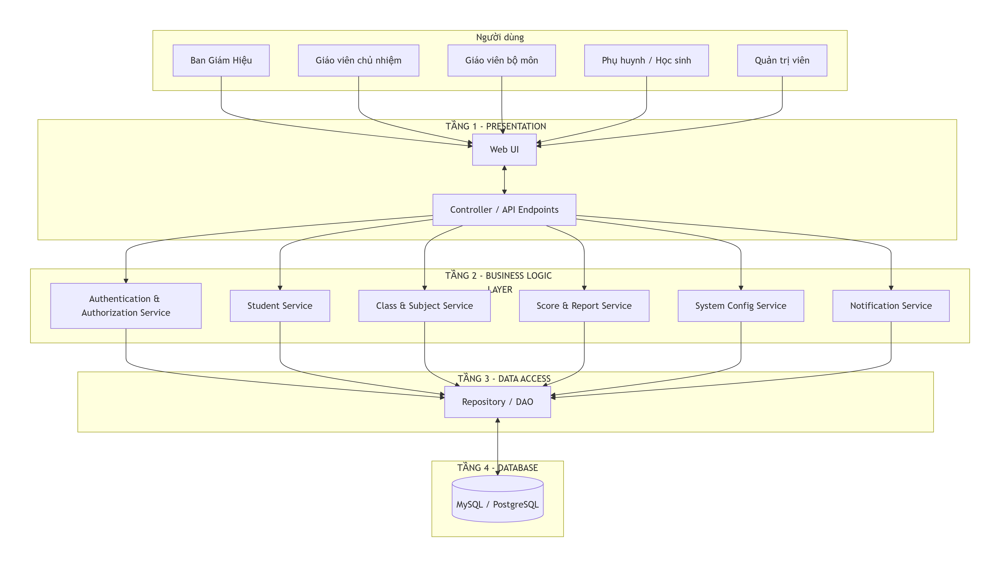
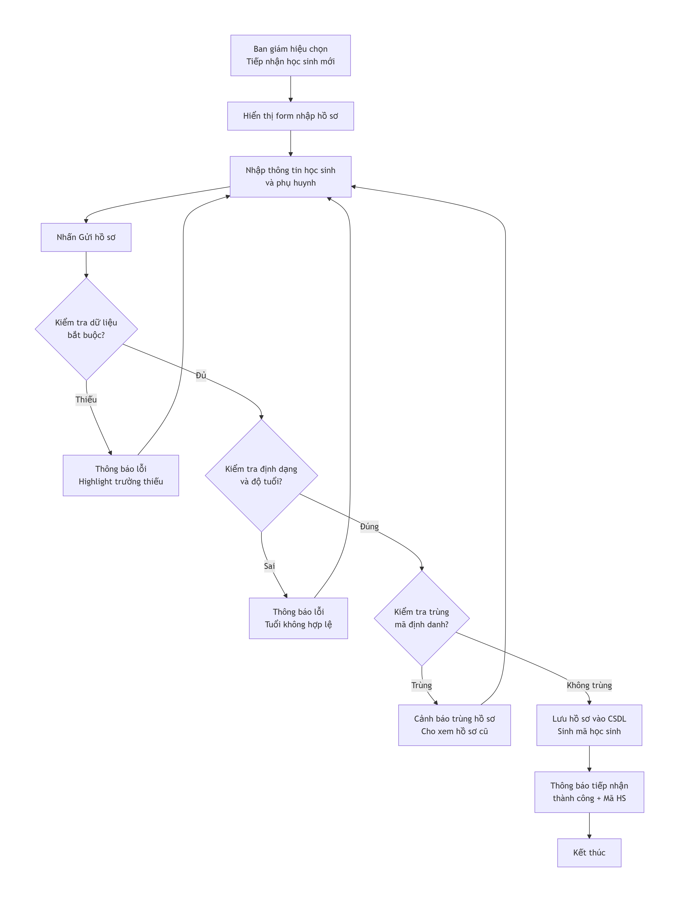
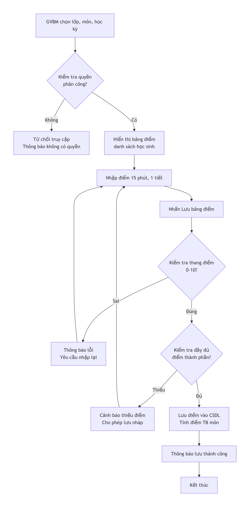

# Thiết kế kiến trúc

Hệ thống Quản lý Học sinh THPT được tổ chức theo kiến trúc 3 lớp. Thiết kế dữ liệu dùng PostgreSQL và mô hình 14 bảng.

Tài liệu liên quan: [Cơ sở dữ liệu](database-design.md) · [Giao diện](ui-design.md).

## Lựa chọn mô hình kiến trúc

### Các mô hình có thể lựa chọn

Một số mô hình kiến trúc phổ biến gồm:

#### + Layered Architecture: chia hệ thống thành các lớp theo trách nhiệm.

#### + MVC: phân chia Model, View và Controller trong tổ chức ứng dụng.

#### + 3-Tier Architecture: chia thành tầng trình bày, tầng nghiệp vụ và tầng dữ liệu.

#### + Microservices: chia hệ thống thành các dịch vụ có thể triển khai độc lập.

Đối với đề tài này, báo cáo lựa chọn kiến trúc 3 lớp, đồng thời có thể tổ chức tầng trình bày theo MVC.

Hai khái niệm này không hoàn toàn giống nhau: 3-Tier mô tả cách phân chia các tầng của hệ thống, còn MVC mô tả cách tổ chức thành phần trong ứng dụng. Nhóm có thể áp dụng MVC trong tầng trình bày nhưng không bắt buộc phải xây dựng một hệ thống phân tán.

### Mô hình được lựa chọn

- Đối với đề tài Hệ thống Quản lý Học sinh THPT, nhóm lựa chọn Kiến trúc 3 lớp (3-Tier Architecture) làm mô hình thiết kế tổng thể. Đây là mô hình phù hợp với một hệ thống quản lý tập trung, có quy mô vừa phải, giúp dễ dàng triển khai, bảo trì và giải thích trong bối cảnh học thuật.

- Mô hình này bao gồm ba tầng chính:

+ Presentation Layer (Tầng giao diện): Chịu trách nhiệm tương tác với người dùng.

+ Business Logic Layer (Tầng nghiệp vụ): Xử lý các quy tắc nghiệp vụ, tính toán và điều phối.

+ Data Access Layer (Tầng truy xuất dữ liệu): Thực hiện các thao tác đọc, ghi, cập nhật với cơ sở dữ liệu.

- Bên cạnh đó, trong tầng Presentation, nhóm áp dụng mô hình MVC (Model-View-Controller) để tổ chức mã nguồn giao diện một cách khoa học, tách biệt giữa dữ liệu hiển thị (View), logic điều khiển (Controller) và các đối tượng thực thể (Model). Kiến trúc 3 lớp đảm bảo rằng người dùng không thể truy cập trực tiếp vào cơ sở dữ liệu, mọi yêu cầu đều phải đi qua tầng nghiệp vụ để kiểm tra tính hợp lệ và các quy định.

## Sơ đồ kiến trúc tổng thể

### Sơ đồ

Sơ đồ dưới đây mô tả luồng tương tác giữa các thành phần trong hệ thống Quản lý Học sinh THPT, từ người dùng đến cơ sở dữ liệu.

### Giải thích sơ đồ

- Người dùng (Ban giám hiệu, Giáo viên, Phụ huynh, Quản trị viên) thao tác trên giao diện web (Web UI)

- Yêu cầu từ người dùng được gửi đến Controller/API tương ứng. Controller đóng vai trò tiếp nhận, kiểm tra dữ liệu đầu vào cơ bản và chuyển yêu cầu đến tầng nghiệp vụ

- Tại Tầng nghiệp vụ, các dịch vụ chuyên biệt (Service) sẽ xử lý:

Authentication & Authorization Service: Xác thực và phân quyền

Student Service: Quản lý hồ sơ, tiếp nhận, cập nhật, xóa/lưu trữ học sinh.

Class & Subject Service: Quản lý lớp học, môn học, phân công giảng dạy.

Score & Report Service: Xử lý nhập điểm, tính điểm trung bình, lập báo cáo tổng kết.

System Config Service: Quản lý các quy định (tuổi, sĩ số, điểm đạt).

Notification Service: Gửi thông báo qua SMS Brandname.

- Khi cần tương tác với dữ liệu, các dịch vụ này sẽ gọi đến Repository/DAO ở tầng truy xuất dữ liệu

- Repository/DAO thực hiện các câu lệnh truy vấn đến Cơ sở dữ liệu (PostgreSQL) và trả kết quả về cho tầng nghiệp vụ

## Mô tả trách nhiệm từng lớp

### Presentation Layer

Chức năng: Tiếp nhận thao tác từ người dùng, hiển thị thông tin và kết quả xử lý.

Các thành phần chính:

Các màn hình giao diện (Views):

Màn hình Đăng nhập

Màn hình Tiếp nhận và Quản lý hồ sơ học sinh

Màn hình Lập danh sách lớp và Phân công giảng dạy

Màn hình Nhập bảng điểm

Màn hình Tra cứu và Báo cáo

Màn hình Cấu hình quy định hệ thống

Controller/API Endpoints: Tiếp nhận yêu cầu từ View, thực hiện kiểm tra dữ liệu đầu vào (ví dụ: định dạng ngày tháng, các trường bắt buộc), và gọi đến các dịch vụ nghiệp vụ tương ứng.

Trách nhiệm: Kiểm tra dữ liệu đầu vào cơ bản, hiển thị thông báo lỗi/thành công, và đảm bảo trải nghiệm người dùng. Các quy tắc nghiệp vụ quan trọng (như kiểm tra tuổi, sĩ số) phải được xử lý ở tầng Business Logic, không chỉ dựa vào kiểm tra ở giao diện

### Business Logic Layer

Chức năng: Đây là trái tim của hệ thống, nơi chứa tất cả các quy tắc nghiệp vụ và logic xử lý.

| Thành phần | Trách nhiệm |
| --- | --- |
| Authentication Service | Xác thực người dùng dựa trên tên đăng nhập và mật khẩu đã băm |
| Authorization Service | Kiểm tra quyền hạn của người dùng đối với từng chức năng (ví dụ: chỉ GVBM mới được nhập điểm môn mình phụ trách) |
| Student Service | Xử lý logic tiếp nhận học sinh mới (kiểm tra độ tuổi theo cấu hình và trùng mã định danh), cập nhật, xóa/lưu trữ hồ sơ |
| Class & Subject Service | Xử lý logic xếp lớp (kiểm tra sĩ số tối đa theo cấu hình), chuyển lớp, quản lý danh mục môn học, phân công giáo viên |
| Score & Report Service | Xử lý logic nhập điểm (kiểm tra thang điểm 0-10), tự động tính điểm trung bình môn, điểm trung bình học kỳ, và tổng hợp dữ liệu cho các báo cáo tổng kết |
| System Config Service | Quản lý và cung cấp các tham số quy định (tuổi tối thiểu/tối đa, sĩ số tối đa, điểm đạt) cho các service khác |
| Notification Service | Điều phối việc gửi thông báo đến phụ huynh thông qua hệ thống SMS Brandname bên ngoài |

### Data Access Layer

- Chức năng: Cung cấp một giao diện trừu tượng để tầng nghiệp vụ tương tác với cơ sở dữ liệu, che giấu các chi tiết phức tạp của SQL.

- Thành phần chính (các Repository/DAO):

UserRepository

StudentRepository

ClassRepository

SubjectRepository

ScoreRepository

SystemConfigRepository

NotificationLogRepository

- Trách nhiệm: Thực hiện các thao tác CRUD (Create, Read, Update, Delete), đảm bảo các truy vấn được tham số hóa để chống SQL Injection, quản lý giao dịch (transaction) khi cần cập nhật nhiều bảng cùng lúc.

### Database Layer

Chức năng: Lưu trữ toàn bộ dữ liệu của hệ thống một cách bền vững.

Hệ quản trị CSDL: PostgreSQL.

Dữ liệu lưu trữ gồm 14 bảng: NguoiDung, HocSinh, LopHoc, MonHoc, PhanLop, PhanCong, LichDay, QuyDinh, BangDiemMon, DiemThanhPhan, KetQuaHocKy, TheoDoiHocSinh, ThongBao, LichSuGuiTin.

## Mô tả luồng xử lý nghiệp vụ Tiếp nhận học sinh mới

### Quy trình nghiệp vụ

Quy trình tiếp nhận học sinh mới gồm các bước:

Ban giám hiệu (BGH) đăng nhập vào hệ thống.

Chọn chức năng "Tiếp nhận học sinh mới".

Hệ thống hiển thị form nhập hồ sơ học sinh.

BGH nhập thông tin cá nhân, thông tin phụ huynh, giấy tờ tùy thân.

BGH nhấn nút "Gửi hồ sơ".

Hệ thống kiểm tra dữ liệu bắt buộc, định dạng và quy định độ tuổi theo cấu hình.

Hệ thống kiểm tra trùng lặp mã định danh/CCCD.

Nếu tất cả hợp lệ, hệ thống lưu hồ sơ, sinh mã học sinh tự động và thông báo thành công.

Nếu có lỗi, hệ thống hiển thị thông báo tương ứng và yêu cầu chỉnh sửa.

### Sơ đồ luồng xử lý

### Mô tả dữ liệu đầu vào và đầu ra

| Nội dung | Mô tả |
| --- | --- |
| Đầu vào | Họ tên, ngày sinh, giới tính, địa chỉ, CCCD, email, họ tên phụ huynh, SĐT phụ huynh |
| Dữ liệu kiểm tra | Quy định độ tuổi theo cấu hình, định dạng email/SĐT, trùng CCCD, trường bắt buộc |
| Dữ liệu cập nhật | Hồ sơ HocSinh và liên kết phụ huynh trong NguoiDung. |
| Đầu ra thành công | Mã học sinh mới, thông báo "Tiếp nhận thành công" |
| Đầu ra thất bại | Mã lỗi hoặc thông báo giải thích lý do từ chối (tuổi không hợp lệ, trùng CCCD, thiếu trường) |

### Các tình huống cần kiểm thử

Tiếp nhận học sinh với đầy đủ thông tin hợp lệ.

Nhập thiếu trường bắt buộc (họ tên, ngày sinh, CCCD).

Nhập ngày sinh khiến tuổi ngoài khoảng được cấu hình cho khối.

Nhập CCCD đã tồn tại trong hệ thống.

Nhập email sai định dạng.

Nhập SĐT phụ huynh không hợp lệ.

Lỗi kết nối CSDL trong lúc lưu hồ sơ.

Hai người dùng đồng thời tiếp nhận cùng một CCCD

## Mô tả luồng xử lý nghiệp vụ Nhập bảng điểm môn học

### Quy trình nghiệp vụ

Quy trình nhập bảng điểm môn học gồm các bước:

Giáo viên bộ môn (GVBM) đăng nhập vào hệ thống.

Chọn lớp, môn học và học kỳ cần nhập điểm.

Hệ thống kiểm tra quyền của GVBM đối với lớp/môn được phân công.

Hệ thống hiển thị bảng điểm với danh sách học sinh và các cột điểm thường xuyên, giữa kỳ và cuối kỳ.

GVBM nhập điểm cho từng học sinh.

GVBM nhấn nút "Lưu bảng điểm".

Hệ thống kiểm tra thang điểm 0–10 và các ràng buộc

Hệ thống lưu điểm vào CSDL và tự động tính điểm trung bình môn

Hệ thống hiển thị thông báo lưu thành công và cập nhật bảng điểm

### Sơ đồ luồng xử lý

### Mô tả dữ liệu đầu vào và đầu ra

| Nội dung | Mô tả |
| --- | --- |
| Đầu vào | Mã GVBM từ phiên đăng nhập, mã lớp, mã môn, học kỳ, danh sách điểm |
| Dữ liệu kiểm tra | Quyền phân công, thang điểm 0–10, đầy đủ điểm thành phần |
| Dữ liệu cập nhật | Bản ghi trong BangDiemMon và DiemThanhPhan. |
| Đầu ra thành công | Thông báo "Lưu bảng điểm thành công", điểm TB môn được cập nhật |
| Đầu ra thất bại | Mã lỗi hoặc thông báo giải thích lý do từ chối (không có quyền, điểm không hợp lệ, thiếu điểm) |

### Các tình huống cần kiểm thử

GVBM nhập điểm hợp lệ cho tất cả học sinh trong lớp.

GVBM nhập điểm ngoài khoảng 0–10.

GVBM nhập điểm không phải là số.

GVBM không được phân công dạy lớp/môn đó.

GVBM lưu bảng điểm khi thiếu điểm thành phần.

Bảng điểm đã hoàn tất và người dùng chưa có quyền mở lại để chỉnh sửa.

Lỗi kết nối CSDL trong lúc lưu điểm.

Hai GVBM cùng nhập điểm cho cùng một lớp/môn (xung đột dữ liệu)

## Lý do lựa chọn kiến trúc

| Tiêu chí | Lợi ích của kiến trúc 3 lớp |
| --- | --- |
| Dễ bảo trì | Mỗi tầng có trách nhiệm riêng, dễ dàng sửa đổi mà không ảnh hưởng đến các tầng khác |
| Dễ kiểm thử | Các quy tắc nghiệp vụ (kiểm tra tuổi, sĩ số, thang điểm) tập trung ở tầng Business Logic, có thể kiểm thử độc lập. |
| Dễ mở rộng | Có thể bổ sung chức năng mới (báo cáo nâng cao, tích hợp SMS) mà không cần viết lại toàn bộ hệ thống. |
| Bảo mật | Tầng giao diện không truy cập trực tiếp vào CSDL; mọi yêu cầu phải qua tầng nghiệp vụ để kiểm tra quyền và dữ liệu. |
| Tính nhất quán | Các quy tắc nghiệp vụ (tính điểm TB, kiểm tra sĩ số) được tập trung một nơi, đảm bảo mọi chức năng áp dụng cùng logic. |
| Phù hợp quy mô | Có thể triển khai như một ứng dụng nguyên khối, đơn giản hóa vận hành cho một trường THPT. |

Nhược điểm: Nếu ranh giới giữa các tầng không rõ ràng, mã nguồn có thể bị phụ thuộc chặt chẽ. Nhóm cần quy định rõ cách gọi giữa các tầng, cách xử lý lỗi và cách kiểm thử.
