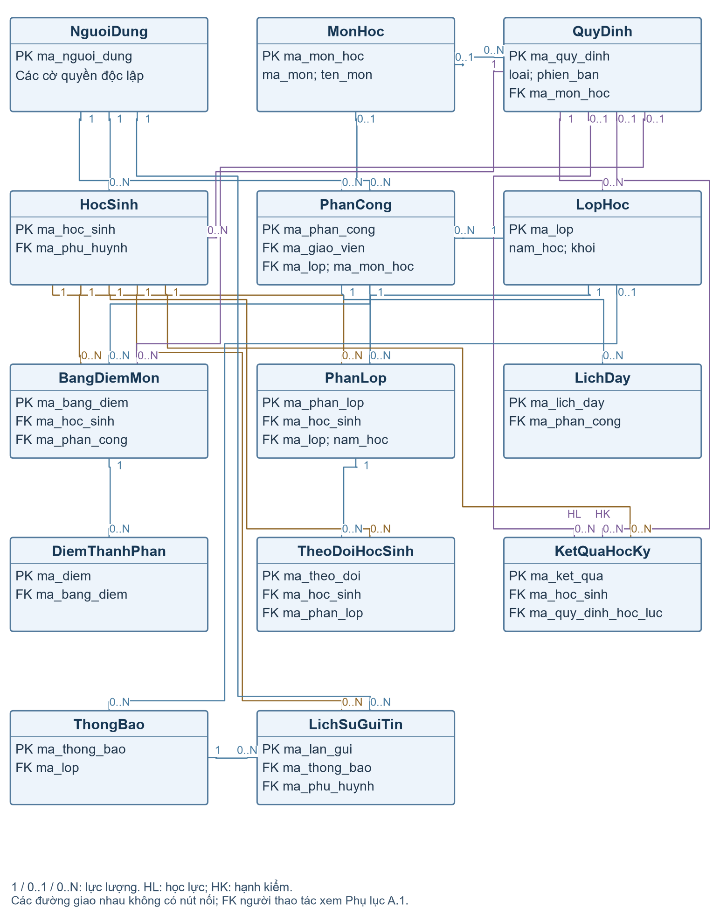

# Thiết kế cơ sở dữ liệu

Tài liệu liên quan: [Kiến trúc](architecture.md) · [Schema PostgreSQL 14 bảng](database/schema.sql) · [ERD A4](reference/ERD_14_bang_A4.pdf) · [Ràng buộc và tham số](database/constraints-and-rules.md).

## Xác định các thực thể

### Nguyên tắc thiết kế

Cơ sở dữ liệu của hệ thống quản lý học sinh THPT được thiết kế theo mô hình quan hệ và sử dụng PostgreSQL. Mỗi bảng lưu một nhóm dữ liệu nghiệp vụ; khóa chính và khóa ngoại xác định bản ghi, liên kết dữ liệu và bảo đảm tính toàn vẹn. Tên thực thể dùng dạng HocSinh, tên vật lý dùng dạng hoc_sinh.

Thiết kế sử dụng 14 bảng chính:

| STT | Bảng | Ý nghĩa |
| --- | --- | --- |
| 1 | NguoiDung | Tài khoản, hồ sơ dùng chung và các quyền người dùng |
| 2 | HocSinh | Hồ sơ và thông tin tiếp nhận học sinh |
| 3 | LopHoc | Lớp, khối, năm học và giới hạn sĩ số |
| 4 | MonHoc | Danh mục môn học |
| 5 | PhanLop | Quá trình xếp và chuyển lớp theo thời gian |
| 6 | PhanCong | Nhiệm vụ chủ nhiệm và giảng dạy của giáo viên |
| 7 | LichDay | Buổi, tiết và phòng học của phân công |
| 8 | QuyDinh | Quy định có loại, phạm vi và phiên bản |
| 9 | BangDiemMon | Kết quả môn, trạng thái và phiên bản cập nhật |
| 10 | DiemThanhPhan | Từng điểm thường xuyên, giữa kỳ và cuối kỳ |
| 11 | KetQuaHocKy | Học lực và hạnh kiểm theo học kỳ |
| 12 | TheoDoiHocSinh | Điểm danh và các sự kiện vi phạm |
| 13 | ThongBao | Nội dung thông báo |
| 14 | LichSuGuiTin | Người nhận và kết quả từng lần gửi SMS |

### Giải thích các thực thể quan trọng

NguoiDung lưu đăng nhập và thông tin dùng chung. PhanCong xác định nhiệm vụ chủ nhiệm/bộ môn của giáo viên.

HocSinh là thực thể trung tâm; PhanLop liên kết học sinh với lớp theo từng giai đoạn, giữ cả hiện tại và lịch sử.

BangDiemMon quản lý kết quả môn; DiemThanhPhan lưu từng đầu điểm. KetQuaHocKy lưu học lực/hạnh kiểm với trạng thái xử lý riêng.

QuyDinh giữ tham số theo loại và phiên bản. TheoDoiHocSinh lưu điểm danh/vi phạm; ThongBao và LichSuGuiTin quản lý gửi tin.

## Sơ đồ ERD

### Sơ đồ thực thể và quan hệ

Hình 2.1 thể hiện đủ 14 bảng. Ký hiệu số 1, 0..1 và 0..N biểu diễn lực lượng quan hệ. Hình trình bày PK và các FK chính.

Hình 2.1 – ERD hệ thống quản lý học sinh với 14 bảng

### Giải thích các quan hệ

| Quan hệ | Lực lượng | Giải thích |
| --- | --- | --- |
| NguoiDung – HocSinh | 1–0..N | Một phụ huynh đại diện nhiều học sinh; mỗi học sinh có một người đại diện. |
| HocSinh – PhanLop | 1–0..N | Mỗi dòng là một giai đoạn học tại lớp. |
| LopHoc – PhanLop | 1–0..N | Một lớp có nhiều lượt phân lớp theo thời gian. |
| NguoiDung – PhanCong | 1–0..N | Một giáo viên có nhiều nhiệm vụ được giao. |
| MonHoc – PhanCong | 0..1–0..N | Phân công BM có môn; CN không có môn. |
| PhanCong – LichDay | 1–0..N | Một phân công BM có thể có nhiều buổi dạy. |
| HocSinh – BangDiemMon | 1–0..N | Bảng điểm được xác định theo môn/năm/học kỳ. |
| BangDiemMon – DiemThanhPhan | 1–0..N | Một kết quả môn chứa nhiều đầu điểm. |
| HocSinh – KetQuaHocKy | 1–0..N | Mỗi năm/học kỳ có tối đa một dòng kết quả. |
| PhanLop – TheoDoiHocSinh | 1–0..N | Sự kiện giữ đúng bối cảnh lớp của học sinh. |
| QuyDinh – BangDiemMon | 0..1–0..N | Bảng điểm nháp có thể chưa chọn quy định; hoàn tất phải có quy định. |
| ThongBao – LichSuGuiTin | 1–0..N | Một nội dung có nhiều đích nhận/lần gửi. |

## Mô tả các bảng dữ liệu

Các bảng dưới đây trình bày mục đích và ý nghĩa của từng trường. Kiểu dữ liệu và các cờ khóa được tổng hợp tại [Data Dictionary](#data-dictionary).

### Bảng NguoiDung

Bảng NguoiDung (nguoi_dung). Lưu thông tin tài khoản, giáo viên và phụ huynh trong cùng một hồ sơ. Các cờ quyền cho phép một người có nhiều vai trò; nhiệm vụ chủ nhiệm/bộ môn được xác định qua PhanCong.

| Trường | Ý nghĩa |
| --- | --- |
| ma_nguoi_dung | Định danh người dùng. |
| ho_ten | Họ và tên. |
| email | Email liên hệ/khôi phục. |
| so_dien_thoai | Số liên hệ; bắt buộc với phụ huynh. |
| ten_dang_nhap | Tên đăng nhập; có thể chưa cấp. |
| mat_khau_bam | Mật khẩu đã băm. |
| la_qtv | Có quyền quản trị viên. |
| la_bgh | Có quyền ban giám hiệu. |
| la_giao_vien | Có hồ sơ giáo viên; nhiệm vụ theo PhanCong. |
| la_phu_huynh | Có hồ sơ phụ huynh. |
| ma_so_giao_vien | Mã giáo viên; bắt buộc nếu là giáo viên. |
| trang_thai | CHO_CAP, HOAT_DONG hoặc KHOA. |
| so_lan_sai | Số lần sai mật khẩu liên tiếp. |
| khoa_den | Thời điểm hết khóa tạm thời. |

### Bảng HocSinh

Bảng HocSinh (hoc_sinh). Lưu hồ sơ, mã định danh, thông tin tiếp nhận và phụ huynh đại diện. Lớp hiện tại và quá trình chuyển lớp được tra cứu qua PhanLop.

| Trường | Ý nghĩa |
| --- | --- |
| ma_hoc_sinh | Khóa hồ sơ học sinh. |
| ma_so_hoc_sinh | Mã học sinh hiển thị. |
| ma_dinh_danh | CCCD/mã định danh; lưu dạng chuỗi. |
| ho_ten | Họ và tên học sinh. |
| ngay_sinh | Ngày sinh để kiểm tra tuổi. |
| gioi_tinh | NAM, NU hoặc KHAC. |
| dia_chi | Địa chỉ liên hệ. |
| ma_phu_huynh | NguoiDung có quyền phụ huynh. |
| ngay_tiep_nhan | Ngày làm mốc xét tuổi. |
| khoi_tiep_nhan | Khối 10, 11 hoặc 12 khi tiếp nhận. |
| ma_quy_dinh_tuoi | Quy định tuổi đã áp dụng. |
| trang_thai | DANG_HOC hoặc LUU_TRU. |
| nguoi_tiep_nhan | BGH thực hiện tiếp nhận. |

### Bảng LopHoc

Bảng LopHoc (lop_hoc). Lưu lớp theo năm học, khối và giới hạn sĩ số. Sĩ số hiện tại được tính từ các dòng PhanLop còn hiệu lực; thông tin GVCN lấy từ PhanCong.

| Trường | Ý nghĩa |
| --- | --- |
| ma_lop | Định danh lớp trong một năm học. |
| ten_lop | Tên lớp, ví dụ 10A1. |
| nam_hoc | Năm học, dạng YYYY-YYYY. |
| khoi | Khối 10, 11 hoặc 12. |
| si_so_toi_da | Giới hạn sĩ số được phê duyệt. |
| ma_quy_dinh_si_so | Quy định tuổi/sĩ số áp dụng. |
| trang_thai | HOAT_DONG hoặc LUU_TRU. |

### Bảng MonHoc

Bảng MonHoc (mon_hoc). Lưu danh mục môn học. Hệ số tính và số đầu điểm chính thức được lấy từ phiên bản QuyDinh tương ứng với năm/khối/môn.

| Trường | Ý nghĩa |
| --- | --- |
| ma_mon_hoc | Định danh môn học. |
| ma_mon | Mã môn nghiệp vụ. |
| ten_mon | Tên môn học. |
| so_tiet | Số tiết theo danh mục. |
| he_so_mac_dinh | Hệ số gợi ý; khi tính dùng QuyDinh. |
| trang_thai | HOAT_DONG hoặc NGUNG. |

### Bảng PhanLop

Bảng PhanLop (phan_lop). Lưu cả phân lớp hiện tại và lịch sử bằng khoảng hiệu lực [tu_luc, den_luc). Chuyển lớp kết thúc dòng trước và thêm dòng mới, giữ được quá trình học mà không cần bảng lịch sử riêng.

| Trường | Ý nghĩa |
| --- | --- |
| ma_phan_lop | Định danh một giai đoạn học tại lớp. |
| ma_hoc_sinh | Học sinh được xếp lớp. |
| ma_lop | Lớp của giai đoạn này. |
| nam_hoc | Năm học, phải khớp LopHoc. |
| tu_luc | Thời điểm bắt đầu có hiệu lực. |
| den_luc | NULL nếu là lớp hiện tại trong năm. |
| ly_do | Lý do xếp hoặc chuyển lớp. |
| nguoi_thuc_hien | BGH thực hiện thao tác. |

### Bảng PhanCong

Bảng PhanCong (phan_cong). Liên kết giáo viên, lớp, môn và học kỳ; loại CN/BM phân biệt hai nhiệm vụ. Một người có thể có nhiều phân công và đảm nhiệm cả chủ nhiệm lẫn giảng dạy.

| Trường | Ý nghĩa |
| --- | --- |
| ma_phan_cong | Định danh phân công. |
| ma_giao_vien | NguoiDung có hồ sơ giáo viên. |
| ma_lop | Lớp được giao phụ trách. |
| nam_hoc | Năm học của lớp. |
| hoc_ky | Học kỳ 1 hoặc 2. |
| loai | CN: chủ nhiệm; BM: bộ môn. |
| ma_mon_hoc | Có môn khi BM; NULL khi CN. |
| trang_thai | HOAT_DONG hoặc NGUNG. |

### Bảng LichDay

Bảng LichDay (lich_day). Lưu nhiều buổi dạy cho một phân công bộ môn. Tầng nghiệp vụ kiểm tra trùng tiết theo giáo viên, lớp và phòng trong cùng năm/học kỳ.

| Trường | Ý nghĩa |
| --- | --- |
| ma_lich_day | Định danh buổi/tiết dạy định kỳ. |
| ma_phan_cong | Phân công BM liên quan. |
| thu | 2–8; 8 biểu diễn Chủ nhật nếu có. |
| tiet_bat_dau | Tiết bắt đầu. |
| tiet_ket_thuc | Tiết kết thúc. |
| phong_hoc | Phòng học nếu đã bố trí. |

### Bảng QuyDinh

Bảng QuyDinh (quy_dinh). Lưu quy định có phân loại, phạm vi và phiên bản trong một bảng. Tham số JSONB có cấu trúc được kiểm tra riêng theo từng loại trước khi áp dụng; hồ sơ/kết quả giữ mã phiên bản đã dùng.

| Trường | Ý nghĩa |
| --- | --- |
| ma_quy_dinh | Định danh một phiên bản quy định. |
| loai | TUOI_SI_SO, DIEM_MON, HOC_LUC, HANH_KIEM. |
| nam_hoc | Năm học áp dụng. |
| khoi | Khối áp dụng. |
| ma_mon_hoc | Bắt buộc khi loại DIEM_MON. |
| phien_ban | Số phiên bản trong cùng phạm vi. |
| trang_thai | NHAP, AP_DUNG hoặc NGUNG. |
| tham_so | Đối tượng tham số theo loại quy định. |
| nguoi_tao | BGH/QTV lập cấu hình. |
| tao_luc | Thời điểm tạo phiên bản. |

### Bảng BangDiemMon

Bảng BangDiemMon (bang_diem_mon). Lưu trung bình, trạng thái và phiên bản của bảng điểm một học sinh/môn/năm/học kỳ. Bảng này quản lý đơn vị cập nhật; các giá trị điểm gốc nằm tại DiemThanhPhan.

| Trường | Ý nghĩa |
| --- | --- |
| ma_bang_diem | Định danh kết quả môn của học sinh. |
| ma_hoc_sinh | Học sinh có bảng điểm. |
| ma_mon_hoc | Môn được đánh giá. |
| nam_hoc | Năm học của kết quả. |
| hoc_ky | Học kỳ 1 hoặc 2. |
| ma_phan_cong | Phân công BM đúng môn/năm/học kỳ. |
| ma_quy_dinh_diem | Quy định tính điểm; bắt buộc khi hoàn tất. |
| diem_trung_binh | NULL khi nháp; có giá trị khi hoàn tất. |
| trang_thai | NHAP hoặc HOAN_TAT. |
| phien_ban | Phiên bản cập nhật để phát hiện xung đột. |
| nhan_xet | Nhận xét theo môn. |
| nguoi_cap_nhat | Giáo viên thực hiện cập nhật. |
| cap_nhat_luc | Thời điểm cập nhật gần nhất. |

### Bảng DiemThanhPhan

Bảng DiemThanhPhan (diem_thanh_phan). Lưu từng điểm TX/GK/CK bằng một dòng có giá trị số. Số TX linh hoạt; mỗi bảng điểm có tối đa một GK và một CK. Chưa nhập điểm được biểu diễn bằng việc chưa có dòng tương ứng.

| Trường | Ý nghĩa |
| --- | --- |
| ma_diem | Định danh một đầu điểm. |
| ma_bang_diem | Bảng điểm môn sở hữu đầu điểm. |
| loai_diem | TX, GK hoặc CK. |
| lan | Số lần TX; GK/CK luôn bằng 1. |
| gia_tri | Giá trị điểm trong khoảng 0–10. |
| nguoi_nhap | Người nhập hoặc sửa đầu điểm. |
| cap_nhat_luc | Thời điểm cập nhật. |

### Bảng KetQuaHocKy

Bảng KetQuaHocKy (ket_qua_hoc_ky). Lưu học lực và hạnh kiểm theo cùng khóa học sinh/năm/học kỳ. Hai quy trình có trạng thái riêng: xác nhận học lực không tự phê duyệt hạnh kiểm; GVCN đề xuất, BGH duyệt.

| Trường | Ý nghĩa |
| --- | --- |
| ma_ket_qua | Định danh kết quả học sinh/học kỳ. |
| ma_hoc_sinh | Học sinh được tổng hợp/đánh giá. |
| nam_hoc | Năm học của kết quả. |
| hoc_ky | Học kỳ 1 hoặc 2. |
| ma_quy_dinh_hoc_luc | Chuẩn HOC_LUC; bắt buộc khi xác nhận. |
| diem_trung_binh | Trung bình học kỳ khi đã đủ dữ liệu. |
| hoc_luc | Tên mức học lực đã xác định. |
| trang_thai_hoc_luc | NHAP, XAC_NHAN hoặc CAN_CAP_NHAT. |
| ma_quy_dinh_hanh_kiem | Chuẩn HANH_KIEM dùng khi đánh giá. |
| hanh_kiem_de_xuat | Mức GVCN đề xuất. |
| hanh_kiem_duyet | Mức được BGH phê duyệt. |
| nhan_xet | Nhận xét hạnh kiểm. |
| trang_thai_hanh_kiem | CHUA_DANH_GIA, DE_XUAT hoặc DA_DUYET. |
| nguoi_de_xuat | GVCN đề xuất hạnh kiểm. |
| nguoi_duyet | BGH phê duyệt hạnh kiểm. |
| duyet_luc | Thời điểm phê duyệt. |
| phien_ban | Phiên bản cập nhật của kết quả. |

### Bảng TheoDoiHocSinh

Bảng TheoDoiHocSinh (theo_doi_hoc_sinh). Lưu sự kiện theo dõi học sinh theo ngày, có loại DIEM_DANH hoặc VI_PHAM. Các trường bắt buộc phụ thuộc loại; liên kết phân lớp giữ được bối cảnh khi học sinh chuyển lớp.

| Trường | Ý nghĩa |
| --- | --- |
| ma_theo_doi | Định danh bản ghi theo dõi. |
| ma_hoc_sinh | Học sinh được ghi nhận. |
| ma_phan_lop | Giai đoạn lớp tại thời điểm phát sinh. |
| loai | DIEM_DANH hoặc VI_PHAM. |
| ngay | Ngày điểm danh hoặc vi phạm. |
| buoi | SANG/CHIEU khi điểm danh. |
| trang_thai | CO_MAT, VANG_CP, VANG_KP khi điểm danh. |
| noi_dung | Ghi chú; bắt buộc với vi phạm. |
| huong_xu_ly | Cách xử lý vi phạm. |
| nguoi_ghi | GVCN/BGH thực hiện ghi nhận. |
| cap_nhat_luc | Thời điểm ghi/cập nhật. |

### Bảng ThongBao

Bảng ThongBao (thong_bao). Lưu một nội dung dùng cho nhiều người nhận. Từng người nhận và từng lần gửi được lưu trực tiếp tại LichSuGuiTin, không cần bảng người nhận trung gian.

| Trường | Ý nghĩa |
| --- | --- |
| ma_thong_bao | Định danh nội dung thông báo. |
| loai | KET_QUA hoặc THONG_BAO_LOP. |
| tieu_de | Tiêu đề thông báo. |
| noi_dung | Nội dung đã được người gửi xác nhận. |
| nam_hoc | Năm học liên quan. |
| hoc_ky | Học kỳ nếu thông báo kết quả. |
| ma_lop | Lớp liên quan nếu có. |
| nguoi_tao | BGH/QTV/GVCN theo phạm vi quyền. |
| tao_luc | Thời điểm tạo nội dung. |

### Bảng LichSuGuiTin

Bảng LichSuGuiTin (lich_su_gui_tin). Lưu đích nhận, số điện thoại chốt và trạng thái từng lần gửi SMS. Gửi lại tạo dòng mới; timeout được ghi CHUA_XAC_NHAN để đối soát trước khi thử lại.

| Trường | Ý nghĩa |
| --- | --- |
| ma_lan_gui | Định danh một lần gửi đến một đích. |
| ma_thong_bao | Nội dung được gửi. |
| ma_phu_huynh | NguoiDung phụ huynh nhận tin. |
| ma_hoc_sinh | Học sinh làm căn cứ liên kết người nhận. |
| so_dien_thoai_chot | Số nhận tại thời điểm lập yêu cầu. |
| lan | Số lần gửi cho cùng nội dung/PH/HS. |
| khoa_yeu_cau | Khóa chống gửi trùng một lần. |
| nha_cung_cap | Nhà cung cấp SMS. |
| ma_tham_chieu | Mã trả về từ nhà cung cấp. |
| trang_thai | CHO_GUI, DA_GUI, THAT_BAI, CHUA_XAC_NHAN, HUY. |
| yeu_cau_luc | Thời điểm ghi yêu cầu trước khi gọi SMS. |
| phan_hoi_luc | Thời điểm có phản hồi. |
| ma_loi | Mã/lý do lỗi đã chuẩn hóa. |

## Data Dictionary

Phần này tổng hợp kiểu dữ liệu và ràng buộc của toàn bộ 14 bảng. PK: khóa chính; FK: khóa ngoại; UNIQUE: duy nhất; NOT NULL: bắt buộc. FK có thể gồm nhiều cột; đích và nhóm cột tham chiếu được xác định tại [Khóa, ràng buộc và chỉ mục](database/constraints-and-rules.md#constraints). Khóa BIGINT tự tăng dùng GENERATED ALWAYS AS IDENTITY; ngày dùng DATE, thời điểm dùng TIMESTAMPTZ, điểm/hệ số dùng NUMERIC.

| Bảng | Trường | Kiểu dữ liệu | Ràng buộc |
| --- | --- | --- | --- |
| NguoiDung | ma_nguoi_dung | BIGINT | PK, NOT NULL |
| NguoiDung | ho_ten | VARCHAR(100) | NOT NULL |
| NguoiDung | email | VARCHAR(150) | Có thể NULL |
| NguoiDung | so_dien_thoai | VARCHAR(20) | Có thể NULL |
| NguoiDung | ten_dang_nhap | VARCHAR(50) | Có thể NULL, UNIQUE |
| NguoiDung | mat_khau_bam | VARCHAR(255) | Có thể NULL |
| NguoiDung | la_qtv | BOOLEAN | NOT NULL |
| NguoiDung | la_bgh | BOOLEAN | NOT NULL |
| NguoiDung | la_giao_vien | BOOLEAN | NOT NULL |
| NguoiDung | la_phu_huynh | BOOLEAN | NOT NULL |
| NguoiDung | ma_so_giao_vien | VARCHAR(20) | Có thể NULL, UNIQUE |
| NguoiDung | trang_thai | VARCHAR(15) | NOT NULL |
| NguoiDung | so_lan_sai | SMALLINT | NOT NULL |
| NguoiDung | khoa_den | TIMESTAMPTZ | Có thể NULL |
| HocSinh | ma_hoc_sinh | BIGINT | PK, NOT NULL |
| HocSinh | ma_so_hoc_sinh | VARCHAR(20) | NOT NULL, UNIQUE |
| HocSinh | ma_dinh_danh | VARCHAR(20) | NOT NULL, UNIQUE |
| HocSinh | ho_ten | VARCHAR(100) | NOT NULL |
| HocSinh | ngay_sinh | DATE | NOT NULL |
| HocSinh | gioi_tinh | VARCHAR(10) | NOT NULL |
| HocSinh | dia_chi | VARCHAR(255) | NOT NULL |
| HocSinh | ma_phu_huynh | BIGINT | FK, NOT NULL |
| HocSinh | ngay_tiep_nhan | DATE | NOT NULL |
| HocSinh | khoi_tiep_nhan | SMALLINT | NOT NULL |
| HocSinh | ma_quy_dinh_tuoi | BIGINT | FK, NOT NULL |
| HocSinh | trang_thai | VARCHAR(15) | NOT NULL |
| HocSinh | nguoi_tiep_nhan | BIGINT | FK, NOT NULL |
| LopHoc | ma_lop | BIGINT | PK, NOT NULL |
| LopHoc | ten_lop | VARCHAR(20) | NOT NULL |
| LopHoc | nam_hoc | VARCHAR(9) | NOT NULL |
| LopHoc | khoi | SMALLINT | NOT NULL |
| LopHoc | si_so_toi_da | SMALLINT | NOT NULL |
| LopHoc | ma_quy_dinh_si_so | BIGINT | FK, NOT NULL |
| LopHoc | trang_thai | VARCHAR(15) | NOT NULL |
| MonHoc | ma_mon_hoc | BIGINT | PK, NOT NULL |
| MonHoc | ma_mon | VARCHAR(20) | NOT NULL, UNIQUE |
| MonHoc | ten_mon | VARCHAR(100) | NOT NULL |
| MonHoc | so_tiet | SMALLINT | NOT NULL |
| MonHoc | he_so_mac_dinh | NUMERIC(5,2) | NOT NULL |
| MonHoc | trang_thai | VARCHAR(15) | NOT NULL |
| PhanLop | ma_phan_lop | BIGINT | PK, NOT NULL |
| PhanLop | ma_hoc_sinh | BIGINT | FK, NOT NULL |
| PhanLop | ma_lop | BIGINT | FK, NOT NULL |
| PhanLop | nam_hoc | VARCHAR(9) | FK, NOT NULL |
| PhanLop | tu_luc | TIMESTAMPTZ | NOT NULL |
| PhanLop | den_luc | TIMESTAMPTZ | Có thể NULL |
| PhanLop | ly_do | VARCHAR(255) | Có thể NULL |
| PhanLop | nguoi_thuc_hien | BIGINT | FK, NOT NULL |
| PhanCong | ma_phan_cong | BIGINT | PK, NOT NULL |
| PhanCong | ma_giao_vien | BIGINT | FK, NOT NULL |
| PhanCong | ma_lop | BIGINT | FK, NOT NULL |
| PhanCong | nam_hoc | VARCHAR(9) | FK, NOT NULL |
| PhanCong | hoc_ky | SMALLINT | NOT NULL |
| PhanCong | loai | VARCHAR(2) | NOT NULL |
| PhanCong | ma_mon_hoc | BIGINT | FK, Có thể NULL |
| PhanCong | trang_thai | VARCHAR(15) | NOT NULL |
| LichDay | ma_lich_day | BIGINT | PK, NOT NULL |
| LichDay | ma_phan_cong | BIGINT | FK, NOT NULL |
| LichDay | thu | SMALLINT | NOT NULL |
| LichDay | tiet_bat_dau | SMALLINT | NOT NULL |
| LichDay | tiet_ket_thuc | SMALLINT | NOT NULL |
| LichDay | phong_hoc | VARCHAR(30) | Có thể NULL |
| QuyDinh | ma_quy_dinh | BIGINT | PK, NOT NULL |
| QuyDinh | loai | VARCHAR(20) | NOT NULL |
| QuyDinh | nam_hoc | VARCHAR(9) | NOT NULL |
| QuyDinh | khoi | SMALLINT | NOT NULL |
| QuyDinh | ma_mon_hoc | BIGINT | FK, Có thể NULL |
| QuyDinh | phien_ban | SMALLINT | NOT NULL |
| QuyDinh | trang_thai | VARCHAR(10) | NOT NULL |
| QuyDinh | tham_so | JSONB | NOT NULL |
| QuyDinh | nguoi_tao | BIGINT | FK, NOT NULL |
| QuyDinh | tao_luc | TIMESTAMPTZ | NOT NULL |
| BangDiemMon | ma_bang_diem | BIGINT | PK, NOT NULL |
| BangDiemMon | ma_hoc_sinh | BIGINT | FK, NOT NULL |
| BangDiemMon | ma_mon_hoc | BIGINT | FK, NOT NULL |
| BangDiemMon | nam_hoc | VARCHAR(9) | FK, NOT NULL |
| BangDiemMon | hoc_ky | SMALLINT | FK, NOT NULL |
| BangDiemMon | ma_phan_cong | BIGINT | FK, NOT NULL |
| BangDiemMon | ma_quy_dinh_diem | BIGINT | FK, Có thể NULL |
| BangDiemMon | diem_trung_binh | NUMERIC(4,2) | Có thể NULL |
| BangDiemMon | trang_thai | VARCHAR(10) | NOT NULL |
| BangDiemMon | phien_ban | INTEGER | NOT NULL |
| BangDiemMon | nhan_xet | VARCHAR(255) | Có thể NULL |
| BangDiemMon | nguoi_cap_nhat | BIGINT | FK, NOT NULL |
| BangDiemMon | cap_nhat_luc | TIMESTAMPTZ | NOT NULL |
| DiemThanhPhan | ma_diem | BIGINT | PK, NOT NULL |
| DiemThanhPhan | ma_bang_diem | BIGINT | FK, NOT NULL |
| DiemThanhPhan | loai_diem | VARCHAR(2) | NOT NULL |
| DiemThanhPhan | lan | SMALLINT | NOT NULL |
| DiemThanhPhan | gia_tri | NUMERIC(4,2) | NOT NULL |
| DiemThanhPhan | nguoi_nhap | BIGINT | FK, NOT NULL |
| DiemThanhPhan | cap_nhat_luc | TIMESTAMPTZ | NOT NULL |
| KetQuaHocKy | ma_ket_qua | BIGINT | PK, NOT NULL |
| KetQuaHocKy | ma_hoc_sinh | BIGINT | FK, NOT NULL |
| KetQuaHocKy | nam_hoc | VARCHAR(9) | NOT NULL |
| KetQuaHocKy | hoc_ky | SMALLINT | NOT NULL |
| KetQuaHocKy | ma_quy_dinh_hoc_luc | BIGINT | FK, Có thể NULL |
| KetQuaHocKy | diem_trung_binh | NUMERIC(4,2) | Có thể NULL |
| KetQuaHocKy | hoc_luc | VARCHAR(30) | Có thể NULL |
| KetQuaHocKy | trang_thai_hoc_luc | VARCHAR(15) | NOT NULL |
| KetQuaHocKy | ma_quy_dinh_hanh_kiem | BIGINT | FK, Có thể NULL |
| KetQuaHocKy | hanh_kiem_de_xuat | VARCHAR(30) | Có thể NULL |
| KetQuaHocKy | hanh_kiem_duyet | VARCHAR(30) | Có thể NULL |
| KetQuaHocKy | nhan_xet | VARCHAR(500) | Có thể NULL |
| KetQuaHocKy | trang_thai_hanh_kiem | VARCHAR(15) | NOT NULL |
| KetQuaHocKy | nguoi_de_xuat | BIGINT | FK, Có thể NULL |
| KetQuaHocKy | nguoi_duyet | BIGINT | FK, Có thể NULL |
| KetQuaHocKy | duyet_luc | TIMESTAMPTZ | Có thể NULL |
| KetQuaHocKy | phien_ban | INTEGER | NOT NULL |
| TheoDoiHocSinh | ma_theo_doi | BIGINT | PK, NOT NULL |
| TheoDoiHocSinh | ma_hoc_sinh | BIGINT | FK, NOT NULL |
| TheoDoiHocSinh | ma_phan_lop | BIGINT | FK, NOT NULL |
| TheoDoiHocSinh | loai | VARCHAR(10) | NOT NULL |
| TheoDoiHocSinh | ngay | DATE | NOT NULL |
| TheoDoiHocSinh | buoi | VARCHAR(5) | Có thể NULL |
| TheoDoiHocSinh | trang_thai | VARCHAR(15) | Có thể NULL |
| TheoDoiHocSinh | noi_dung | TEXT | Có thể NULL |
| TheoDoiHocSinh | huong_xu_ly | VARCHAR(255) | Có thể NULL |
| TheoDoiHocSinh | nguoi_ghi | BIGINT | FK, NOT NULL |
| TheoDoiHocSinh | cap_nhat_luc | TIMESTAMPTZ | NOT NULL |
| ThongBao | ma_thong_bao | BIGINT | PK, NOT NULL |
| ThongBao | loai | VARCHAR(15) | NOT NULL |
| ThongBao | tieu_de | VARCHAR(150) | NOT NULL |
| ThongBao | noi_dung | TEXT | NOT NULL |
| ThongBao | nam_hoc | VARCHAR(9) | FK, NOT NULL |
| ThongBao | hoc_ky | SMALLINT | Có thể NULL |
| ThongBao | ma_lop | BIGINT | FK, Có thể NULL |
| ThongBao | nguoi_tao | BIGINT | FK, NOT NULL |
| ThongBao | tao_luc | TIMESTAMPTZ | NOT NULL |
| LichSuGuiTin | ma_lan_gui | BIGINT | PK, NOT NULL |
| LichSuGuiTin | ma_thong_bao | BIGINT | FK, NOT NULL |
| LichSuGuiTin | ma_phu_huynh | BIGINT | FK, NOT NULL |
| LichSuGuiTin | ma_hoc_sinh | BIGINT | FK, NOT NULL |
| LichSuGuiTin | so_dien_thoai_chot | VARCHAR(20) | NOT NULL |
| LichSuGuiTin | lan | SMALLINT | NOT NULL |
| LichSuGuiTin | khoa_yeu_cau | VARCHAR(64) | NOT NULL, UNIQUE |
| LichSuGuiTin | nha_cung_cap | VARCHAR(30) | NOT NULL |
| LichSuGuiTin | ma_tham_chieu | VARCHAR(100) | Có thể NULL |
| LichSuGuiTin | trang_thai | VARCHAR(15) | NOT NULL |
| LichSuGuiTin | yeu_cau_luc | TIMESTAMPTZ | NOT NULL |
| LichSuGuiTin | phan_hoi_luc | TIMESTAMPTZ | Có thể NULL |
| LichSuGuiTin | ma_loi | VARCHAR(100) | Có thể NULL |

## Khóa chính, khóa ngoại và ràng buộc dữ liệu

### Khóa chính

Mỗi bảng dùng một khóa BIGINT tự tăng, ổn định và không phụ thuộc tên hiển thị. Ví dụ: NguoiDung.ma_nguoi_dung, HocSinh.ma_hoc_sinh, LopHoc.ma_lop, BangDiemMon.ma_bang_diem và DiemThanhPhan.ma_diem. Mã học sinh, mã giáo viên và mã môn là mã nghiệp vụ có ràng buộc duy nhất, tách biệt với khóa kỹ thuật.

### Khóa ngoại

Khóa ngoại bảo đảm bản ghi được liên kết tồn tại. Ví dụ, HocSinh.ma_phu_huynh tham chiếu NguoiDung.ma_nguoi_dung; DiemThanhPhan.ma_bang_diem tham chiếu BangDiemMon.ma_bang_diem. Khóa ghép giữ PhanLop/PhanCong đúng năm của lớp và BangDiemMon đúng môn/năm/học kỳ của phân công. TheoDoiHocSinh tham chiếu đúng cặp phân lớp/học sinh.

Các FK dùng ON DELETE RESTRICT để bảo vệ dữ liệu đã phát sinh; hồ sơ và lớp có dữ liệu liên quan được chuyển trạng thái lưu trữ. Vai trò người phụ trách/nhận tin và loại quy định được kiểm tra thêm tại Service.

### Ràng buộc duy nhất

Tên đăng nhập, mã học sinh, mã định danh, mã giáo viên và mã môn phải duy nhất. Tên lớp duy nhất trong năm học. Mỗi học sinh/môn/năm/học kỳ có một BangDiemMon; mỗi học sinh/năm/học kỳ có một KetQuaHocKy. Mỗi đầu điểm duy nhất theo bảng điểm/loại/lần; GK và CK chỉ có lần 1.

Chỉ mục có điều kiện bảo đảm một phân lớp hiện tại của học sinh trong năm, một GVCN hoạt động/lớp/học kỳ, một GVBM hoạt động/lớp/môn/học kỳ và một lần điểm danh/học sinh/ngày/buổi. Cùng phạm vi quy định chỉ có một phiên bản AP_DUNG.

### Ràng buộc miền giá trị

Điểm thuộc 0–10; hệ số, số lần và sĩ số phải dương; khối thuộc 10–12; học kỳ thuộc 1–2. Ngày sinh không sau ngày tiếp nhận; khoảng phân lớp phải có kết thúc sau bắt đầu. DIEM_DANH bắt buộc buổi/trạng thái; VI_PHAM bắt buộc nội dung và không dùng trạng thái chuyên cần. Điểm chưa nhập không được thay bằng 0.

### Ràng buộc nghiệp vụ không thể chỉ dựa vào khóa ngoại

Khóa ngoại không tự kiểm soát sĩ số, quyền thao tác, thời gian hiệu lực hoặc tính đầy đủ của điểm. Các quy tắc sau cần kiểm tra tại tầng nghiệp vụ và dùng giao dịch khi ghi nhiều dữ liệu liên quan:

| Nghiệp vụ | Quy tắc cần bảo đảm |
| --- | --- |
| Tiếp nhận và chuyển lớp | Kiểm tra tuổi theo QuyDinh; khóa học sinh và các lớp liên quan khi cập nhật. Đóng giai đoạn cũ và mở giai đoạn mới trong một giao dịch; không chồng khoảng hoặc vượt sĩ số. |
| Nhập và hoàn tất điểm | Kiểm tra phân công, miền điểm và phiên bản cập nhật. NHAP có trung bình NULL; HOAN_TAT chỉ khi đủ thành phần và cấu hình hợp lệ. Lưu điểm, trung bình và trạng thái trong cùng giao dịch. |
| Học lực và hạnh kiểm | Chỉ tổng hợp từ bảng điểm hoàn tất; sửa điểm đánh dấu học lực CAN_CAP_NHAT. Hạnh kiểm có trạng thái độc lập: GVCN đề xuất, BGH duyệt; không tự suy ra từ trung bình môn. |
| Áp dụng quy định | Kiểm tra cấu trúc JSONB theo loại, tuổi min/max, hệ số và chuẩn đánh giá. Quy định đã áp dụng không sửa nội dung; thay đổi tạo phiên bản mới và giữ các tham chiếu lịch sử. |
| Gửi tin và báo cáo | Kiểm tra quyền và liên kết PH–HS trước khi ghi yêu cầu/gửi. Timeout cần đối soát. Báo cáo đọc dữ liệu nhất quán, xuất tệp kết quả; không tạo bảng báo cáo trong CSDL nghiệp vụ. |

Các FK và CHECK chi tiết được liệt kê tại [Khóa, ràng buộc và chỉ mục](database/constraints-and-rules.md#constraints). Cấu trúc tham số và nguyên tắc tính điểm được trình bày tại [Tham số và cách tính kết quả](database/constraints-and-rules.md#parameters).

## Quan hệ giữa các bảng

### Quan hệ học sinh và phân lớp

Một học sinh có thể học nhiều lớp qua thời gian; một lớp có nhiều học sinh. PhanLop là bảng liên kết có khoảng hiệu lực [tu_luc, den_luc). Dòng hiện tại trong năm có den_luc bằng NULL. Khi chuyển lớp, hệ thống kết thúc giai đoạn cũ và mở giai đoạn mới trong cùng giao dịch.

Ví dụ minh họa:

| Học sinh | Lớp / năm học | Giai đoạn |
| --- | --- | --- |
| HS001 | 10A1 / 2026–2027 | 01/09/2026 đến trước 01/10/2026 |
| HS001 | 10A2 / 2026–2027 | Từ 01/10/2026, đang có hiệu lực |
| HS002 | 10A1 / 2026–2027 | Từ 01/09/2026, đang có hiệu lực |

### Quan hệ giáo viên và phân công giảng dạy

NguoiDung lưu hồ sơ giáo viên, còn PhanCong liên kết giáo viên với lớp/học kỳ và môn nếu là nhiệm vụ BM. Loại CN không có môn. Ví dụ GV01 chủ nhiệm 10A1 và dạy Toán 10A2 được lưu bằng hai phân công, không tạo hai hồ sơ. LichDay lưu nhiều buổi/tiết của mỗi phân công BM.

### Quan hệ bảng điểm môn và điểm thành phần

Một BangDiemMon của học sinh/môn/năm/học kỳ có nhiều DiemThanhPhan. Mỗi dòng lưu loại, số lần và giá trị; bảng điểm giữ trung bình, quy định, trạng thái và phiên bản cập nhật. Ví dụ sau có bốn đầu điểm:

| Loại điểm | Lần | Giá trị |
| --- | --- | --- |
| TX | 1 | 7,0 |
| TX | 2 | 8,0 |
| GK | 1 | 7,5 |
| CK | 1 | 8,0 |

Số TX bắt buộc và hệ số lấy từ QuyDinh. Đủ thành phần hợp lệ mới hoàn tất bảng điểm; các kết quả môn hoàn tất là đầu vào tổng hợp KetQuaHocKy. Học lực và hạnh kiểm được lưu cùng phạm vi nhưng có hai trạng thái độc lập.

### Quan hệ thông báo và lịch sử gửi tin

Một ThongBao có nhiều LichSuGuiTin. Mỗi dòng lịch sử gắn nội dung với phụ huynh, học sinh, số điện thoại chốt và một lần gửi. Ví dụ một nội dung gửi tới hai phụ huynh tạo hai dòng lịch sử; gửi lại sau khi đối soát tạo một dòng mới với số lần tăng. Yêu cầu lặp của cùng lần gửi dùng cùng khóa chống trùng. Khi phụ huynh đại diện thay đổi, các dòng đã gửi vẫn giữ đích nhận tại thời điểm phát sinh.

## Đối chiếu ERD với Class Diagram

### Nguyên tắc ánh xạ

Lớp nghiệp vụ có thể ánh xạ trực tiếp, gộp cùng đối tượng dữ liệu hoặc tách thành các bảng theo cấu trúc lưu trữ. Controller/Service xử lý hành vi; các đối tượng báo cáo được dựng từ truy vấn và không bắt buộc có bảng riêng.

### Bảng đối chiếu

| Lớp / quan hệ nghiệp vụ | Bảng / cách lưu trữ | Giải thích ánh xạ |
| --- | --- | --- |
| NguoiDung; QuanTriVien; BanGiamHieu; PhuHuynh | NguoiDung | Thông tin chung lưu một nơi; các cờ quyền phân biệt vai trò. Hồ sơ phụ huynh có thể ở trạng thái CHO_CAP. |
| GiaoVienChuNhiem; GiaoVienBoMon | NguoiDung, PhanCong | Dùng chung hồ sơ giáo viên; CN/BM là nhiệm vụ theo lớp và học kỳ. |
| HocSinh; LopHoc | HocSinh, LopHoc, PhanLop | Tách liên kết có thời gian hiệu lực để lưu cả lớp hiện tại và lịch sử. |
| NamHoc; HocKy; MonHoc | Thuộc tính nam_hoc/hoc_ky; MonHoc | Năm/học kỳ là giá trị có kiểm tra; danh mục môn vẫn là bảng riêng. |
| PhanCong; hành vi quản lý lịch | PhanCong, LichDay | Mỗi phân công có thể có nhiều buổi dạy. |
| BangDiemMon; danh sách điểm | BangDiemMon, DiemThanhPhan | Một bảng quản lý kết quả/trạng thái; một bảng lưu từng đầu điểm. |
| KetQuaHocKy; đánh giá hạnh kiểm | KetQuaHocKy | Cùng khóa học sinh/năm/học kỳ; học lực và hạnh kiểm có cột và trạng thái độc lập. |
| Điểm danh; ghi nhận vi phạm | TheoDoiHocSinh | Gộp các sự kiện theo dõi theo ngày; loại bản ghi quyết định dữ liệu bắt buộc. |
| QuyDinhTuoi; ChuanDiemDat; cấu hình | QuyDinh | Phân loại TUOI_SI_SO, DIEM_MON, HOC_LUC, HANH_KIEM; giữ phạm vi và phiên bản. |
| ThongBao; LichSuGuiTin; SMSBrandnameService | ThongBao, LichSuGuiTin | Hai bảng lưu dữ liệu; dịch vụ gửi tin không có bảng riêng. |
| BaoCao; ChiTietBaoCao | Đối tượng kết quả của Report Service | Quan hệ sở hữu tổng–chi tiết được thể hiện trong bộ nhớ và tệp xuất; không lưu hai bảng báo cáo. |
| Xác thực, nhật ký, sao lưu | Cache phiên/OTP, log và kho sao lưu | Do adapter quản lý; không bổ sung bảng vào CSDL nghiệp vụ. |

### Kiểm tra tính nhất quán

Mọi dữ liệu nghiệp vụ được ánh xạ vào 14 bảng; không có bảng riêng cho mỗi vai trò hoặc mỗi lớp xử lý. Quan hệ nhiều-nhiều được thể hiện qua PhanCong và PhanLop. Các thuộc tính danh sách điểm được chuẩn hóa thành dòng. Phạm vi năm/học kỳ được giữ trong khóa và kiểm tra nghiệp vụ. Các bản xuất báo cáo được lưu ở kho tệp; khả năng tái hiện bản đã phát hành dựa trên tệp đã lưu, không dựa vào bảng ảnh chụp báo cáo.

## Giải thích các quyết định thiết kế

### Vì sao gộp tài khoản, giáo viên và phụ huynh vào NguoiDung?

Các hồ sơ dùng chung thông tin cá nhân và đăng nhập. NguoiDung lưu các cờ quyền độc lập, cho phép một người có nhiều vai trò. Nhiệm vụ chủ nhiệm/bộ môn được xác định qua PhanCong, tránh sao chép hồ sơ cho mỗi nhiệm vụ.

### Vì sao cần bảng PhanLop?

Học sinh có thể chuyển lớp trong năm hoặc học ở lớp khác ở năm tiếp theo. PhanLop lưu liên kết theo thời gian, xác định lớp hiện tại và bối cảnh lớp của dữ liệu theo dõi. Sĩ số được tính từ các dòng còn hiệu lực để tránh lưu số đếm không đồng bộ.

### Vì sao cần tách BangDiemMon và DiemThanhPhan?

BangDiemMon quản lý kết quả môn, trạng thái nháp/hoàn tất và phiên bản cập nhật. DiemThanhPhan lưu từng điểm gốc, hỗ trợ số TX linh hoạt và kiểm soát trùng loại/lần. Điểm chưa nhập được phân biệt với điểm 0.

### Vì sao cần bảng QuyDinh?

Tuổi, sĩ số, hệ số và chuẩn đánh giá có thể thay đổi. QuyDinh giữ loại, phạm vi và phiên bản đã áp dụng; tham số JSONB có cấu trúc được kiểm tra theo từng loại trước khi sử dụng. Các tham chiếu đã xác nhận được giữ để giải thích kết quả lịch sử.

### Vì sao dùng NUMERIC cho điểm?

Điểm và hệ số cần phép tính thập phân cùng quy tắc làm tròn nhất quán. NUMERIC biểu diễn các giá trị này với độ chính xác xác định. Công thức dùng bộ tham số đã được BGH/QTV xác nhận; thiếu dữ liệu hoặc cấu hình thì chưa xác nhận kết quả hoàn tất.

### Vì sao cần lưu lịch sử?

Lịch sử chuyển lớp, phiên bản quy định và các lần gửi SMS phục vụ tra cứu khi có thay đổi hoặc cần đối soát. Hệ thống giữ bản ghi đã phát sinh thay vì ghi đè thông tin quá khứ. Báo cáo được tổng hợp từ dữ liệu hợp lệ; bản đã phát hành được giữ tại kho tệp để xem lại.
