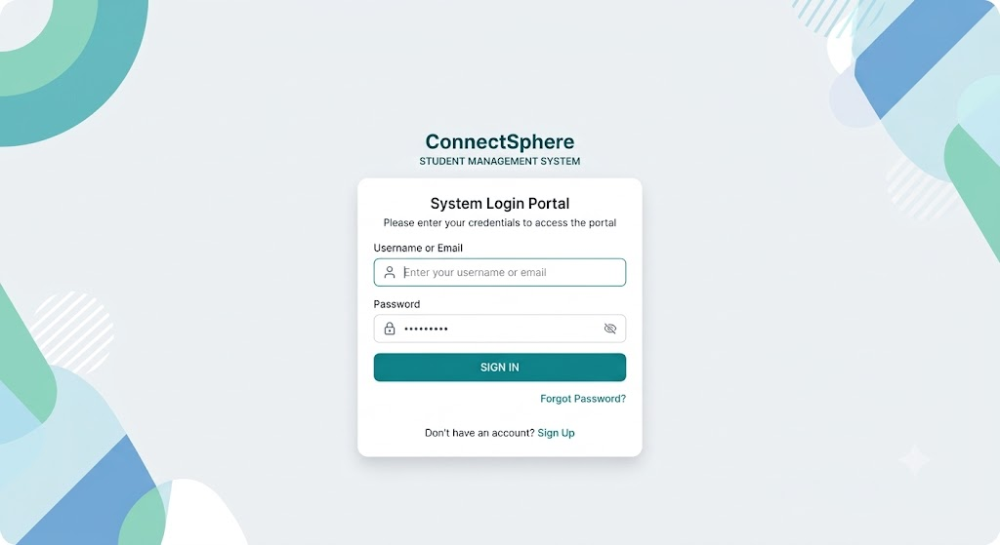
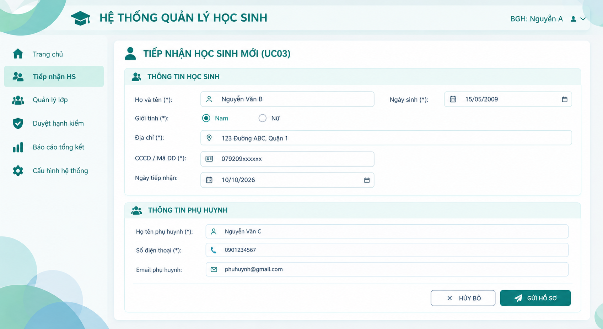
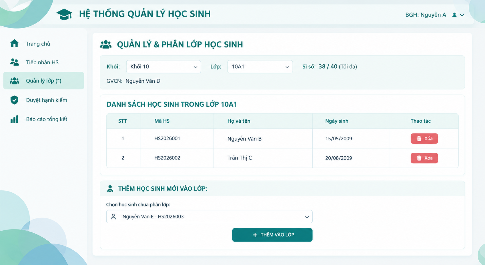
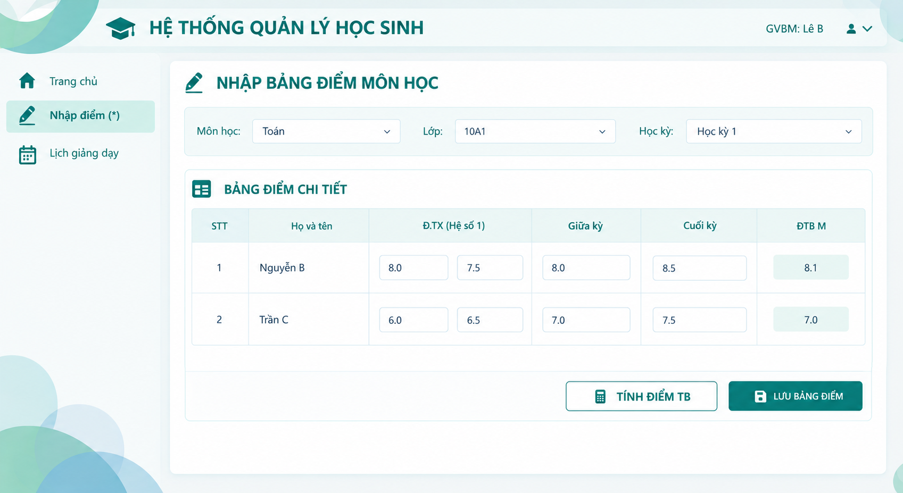
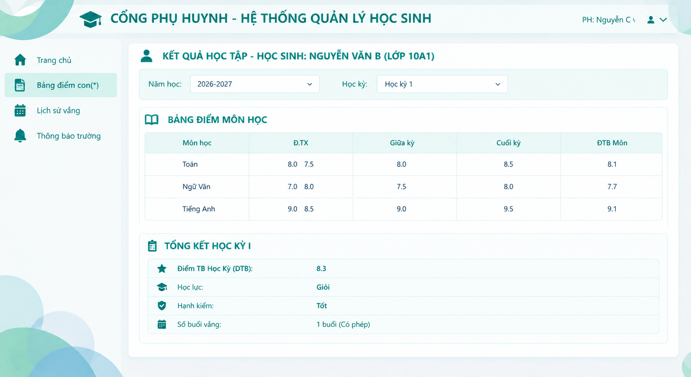

# Thiết kế giao diện

Tài liệu liên quan: [Kiến trúc](architecture.md) · [Cơ sở dữ liệu](database-design.md).

Ngưỡng tuổi và sĩ số được lấy từ quy định áp dụng. Các con số xuất hiện trên wireframe là dữ liệu minh họa.

## Danh sách màn hình và vai trò người dùng

Hệ thống tổ chức các màn hình theo vai trò người dùng và phạm vi nghiệp vụ. Danh sách dưới đây xác định chức năng chính của từng màn hình quản lý học sinh.

| Mã | Màn hình | Vai trò sử dụng | Chức năng |
| --- | --- | --- | --- |
| UI-01 | Đăng nhập | Tất cả người dùng | Xác thực tài khoản để truy cập vào phân hệ chức năng tương ứng dựa trên vai trò |
| UI-02 | Tiếp nhận học sinh mới | Ban giám hiệu | Nhập hồ sơ học sinh mới và kiểm tra quy định tuổi, trùng lặp |
| UI-03 | Quản lý, xếp lớp học sinh | Ban giám hiệu | Tra cứu danh sách, xếp hoặc chuyển học sinh vào lớp, kiểm tra lớp hiện tại và sĩ số theo quy định. |
| UI-04 | Duyệt hạnh kiểm & lập báo cáo tổng kết | Ban giám hiệu | Xem xét, duyệt đề xuất hạnh kiểm và xuất báo cáo tổng kết môn học hoặc học kỳ theo phạm vi được chọn. |
| UI-05 | Nhập điểm môn học | Giáo viên bộ môn | Cho phép GVBM chọn lớp/môn được phân công để nhập/chỉnh sửa các đầu điểm (thường xuyên, giữa kỳ, cuối kỳ) và tính điểm trung bình môn |
| UI-06 | Điểm danh hằng ngày & đánh giá hạnh kiểm | Giáo viên chủ nhiệm | Điểm danh học sinh theo ngày/buổi, ghi nhận đánh giá hạnh kiểm định kỳ và tổng hợp kết quả học kỳ của lớp chủ nhiệm. |
| UI-07 | Gửi thông báo cho phụ huynh | Giáo viên chủ nhiệm, ban giám hiệu | Tạo và gửi thông báo trực tiếp hoặc qua dịch vụ SMS Brandname tới số điện thoại phụ huynh |
| UI-08 | Tra cứu kết quả học tập & điểm danh | Phụ huynh học sinh | Cho phép phụ huynh xem bảng điểm chi tiết các môn, điểm trung bình học kỳ, lịch sử điểm danh và đánh giá hạnh kiểm của con. |
| UI-09 | Quản lý tài khoản, cấu hình hệ thống | Quản trị viên | Quản lý, cấp phát tài khoản người dùng, thiết lập các tham số cấu hình quy định (tuổi tối thiểu/tối đa, chuẩn điểm đạt) và thực hiện sao lưu dữ liệu. |

## Wireframe màn hình đăng nhập

Người dùng: Tất cả người dùng (Admin, BGH, GVCN, GVBM, Phụ huynh).

Mục đích: Xác thực người dùng vào hệ thống.

Trường dữ liệu: tenDangNhap/email, matKhau.

Nút chức năng: Nút [ ĐĂNG NHẬP ], Liên kết Quên mật khẩu?.

Cách phản hồi:

Thành công: Điều hướng đến giao diện tương ứng với vai trò (role).

Thất bại: Hiển thị thông báo "Tên đăng nhập hoặc mật khẩu không chính xác" nếu nhập sai hoặc tài khoản bị khóa.

## Wireframe màn hình tiếp nhận học sinh mới (UI-02, UC03)

Người dùng: Ban Giám Hiệu (BGH).

Mục đích: Nhập thông tin hồ sơ học sinh mới và phụ huynh.

Trường dữ liệu: hoTen, ngaySinh, gioiTinh, diaChi, cccd, ngayTiepNhan, hoTenPhuHuynh, soDienThoai, email.

Nút chức năng: Nút [ GỬI HỒ SƠ ], Nút [ HỦY BỎ ].

Cách phản hồi:

Tuổi không hợp lệ (A1): Báo lỗi "Độ tuổi học sinh không nằm trong quy định của khối". Thiếu thông tin (A2): Highlight đỏ các trường còn thiếu.

Trùng CCCD (A3): Cảnh báo "Mã định danh/CCCD đã tồn tại trên hệ thống".

Thành công: Sinh mã học sinh tự động và hiển thị "Tiếp nhận học sinh thành công - Mã HS: HS2026001"

## Wireframe màn hình quản lý & phân lớp học sinh

Người dùng: Ban Giám Hiệu.

Mục đích: Xếp học sinh đã tiếp nhận vào lớp học theo khối.

Trường dữ liệu: Combobox khoiLop, LopHoc, maHocSinh chưa phân lớp; Hiển thị siSoHienTai, siSoToiDa.

Nút chức năng: Nút [ THÊM VÀO LỚP ], Nút [Xóa].

Cách phản hồi:

Vượt sĩ số: Phản hồi lỗi "Lớp học đã đủ sĩ số tối đa theo cấu hình" nếu siSoHienTai >= siSoToiDa.

Thành công: Thêm học sinh vào lớp, tăng sĩ số và cập nhật danh sách.

## Wireframe màn hình nhập bảng điểm môn học (UI-05)

Người dùng: Giáo viên Bộ môn (GVBM).

Mục đích: Nhập các đầu điểm và tính điểm trung bình môn học.

Trường dữ liệu: diemThuongXuyen, diemGiuaKy, diemCuoiKy, diemTrungBinhMon.

Nút chức năng: Nút [ TÍNH ĐIỂM TB ], Nút [ LƯU BẢNG ĐIỂM ].

Cách phản hồi:

Nhập sai thang điểm: Báo lỗi tô đỏ nếu điểm < 0 hoặc > 10.

Thành công: Tính tự động diemTrungBinhMon và lưu bảng điểm vào cơ sở dữ liệu.

## Wireframe màn hình tra cứu kết quả học tập (UI-08)

Người dùng: Phụ huynh học sinh.

Mục đích: Tra cứu điểm thi, học lực, hạnh kiểm và lịch sử điểm danh của học sinh.

Trường dữ liệu: Dropdown NamHoc, HocKy; Dữ liệu xem (Read-only): diemTrungBinhMon, diemTrungBinhHocKy, hocLuc, hanhKiem.

Nút chức năng: Thao tác chọn Dropdown học kỳ/năm học để tải lại dữ liệu.

Cách phản hồi:

Chưa có dữ liệu: Thông báo "Chưa có kết quả học tập cho học kỳ được chọn".

Có dữ liệu: Hiển thị chi tiết điểm từng môn và tổng kết học kỳ.

## Mô tả thao tác, dữ liệu nhập và phản hồi của hệ thống

### Bảng mô tả giao diện

| Màn hình | Dữ liệu nhập | Xử lý | Phản hồi |
| --- | --- | --- | --- |
| UI-01 – Đăng nhập | Tên đăng nhập/email, mật khẩu | Xác thực thông tin tài khoản, kiểm tra trạng thái tài khoản và phân quyền người dùng | Thành công: chuyển đến giao diện tương ứng với vai trò. Thất bại: thông báo thông tin đăng nhập không chính xác hoặc tài khoản bị khóa. |
| UI-02 – Tiếp nhận học sinh mới | Họ tên, ngày sinh, giới tính, địa chỉ, CCCD/mã định danh, ngày tiếp nhận, họ tên phụ huynh, số điện thoại, email | Kiểm tra trường bắt buộc, định dạng dữ liệu, độ tuổi học sinh theo cấu hình và trùng CCCD/mã định danh; lưu hồ sơ hợp lệ và sinh mã học sinh tự động | Thành công: thông báo tiếp nhận thành công và hiển thị mã học sinh. Thất bại: thông báo lỗi tương ứng, đánh dấu trường cần sửa hoặc cảnh báo thông tin bị trùng. |
| UI-03 – Quản lý và phân lớp học sinh | Khối lớp, lớp học, mã học sinh chưa phân lớp | Truy vấn danh sách học sinh, kiểm tra sĩ số tối đa của lớp, thực hiện thêm hoặc xóa học sinh khỏi lớp và cập nhật sĩ số | Thành công: cập nhật danh sách học sinh và sĩ số lớp. Thất bại: thông báo lớp đã đủ sĩ số hoặc dữ liệu phân lớp không hợp lệ. |
| UI-04 – Duyệt hạnh kiểm và lập báo cáo tổng kết | Học kỳ, năm học, lớp hoặc tiêu chí báo cáo; thông tin duyệt hạnh kiểm | Tổng hợp kết quả học tập, hạnh kiểm; kiểm tra dữ liệu trước khi duyệt, cập nhật trạng thái duyệt và tạo báo cáo theo phạm vi được chọn | Hiển thị kết quả tổng kết, trạng thái duyệt và báo cáo tương ứng. Nếu chưa đủ dữ liệu hoặc không có quyền duyệt, hệ thống thông báo lý do. |
| UI-05 – Nhập điểm môn học | Môn học, lớp, học kỳ, điểm thường xuyên, điểm giữa kỳ, điểm cuối kỳ | Kiểm tra quyền giảng dạy, tính hợp lệ của điểm số, lưu bảng điểm và tính điểm trung bình môn theo quy định | Thành công: hiển thị bảng điểm đã cập nhật và điểm trung bình môn. Thất bại: thông báo điểm không hợp lệ, thiếu dữ liệu hoặc lỗi lưu bảng điểm. |
| UI-06 – Điểm danh hằng ngày | Lớp, ngày điểm danh, buổi học, trạng thái chuyên cần và ghi chú nếu có | Truy xuất danh sách học sinh của lớp, ghi nhận trạng thái có mặt/vắng mặt, kiểm tra dữ liệu và lưu kết quả điểm danh | Thành công: hiển thị danh sách điểm danh đã lưu. Thất bại: thông báo thiếu thông tin, dữ liệu không hợp lệ hoặc kết quả điểm danh chưa được lưu. |
| UI-07 – Tra cứu kết quả học tập | Năm học, học kỳ cần xem | Kiểm tra quyền truy cập, truy vấn điểm các môn học, điểm trung bình học kỳ, học lực và hạnh kiểm của học sinh liên kết với tài khoản phụ huynh | Có dữ liệu: hiển thị bảng điểm và tổng kết học kỳ. Chưa có dữ liệu: thông báo “Chưa có kết quả học tập cho học kỳ được chọn”. |
| UI-08 – Thông báo trường | Từ khóa tìm kiếm hoặc tiêu chí lọc thông báo; nội dung và đối tượng nhận nếu người dùng có quyền tạo thông báo | Truy vấn thông báo theo tiêu chí, kiểm tra quyền tạo và gửi thông báo, lưu nội dung và thông tin liên quan | Hiển thị danh sách thông báo phù hợp hoặc thông báo chưa có dữ liệu. Khi tạo/gửi, hệ thống thông báo kết quả thực hiện hoặc lý do thất bại. |
| UI-09 – Quản lý tài khoản và cấu hình hệ thống | Thông tin tài khoản, vai trò, trạng thái tài khoản và các tham số cấu hình như độ tuổi, sĩ số tối đa, ngưỡng điểm | Kiểm tra quyền quản trị, xác thực dữ liệu, cập nhật tài khoản hoặc tham số cấu hình và lưu thay đổi | Thành công: thông báo cập nhật thành công. Thất bại: thông báo dữ liệu không hợp lệ, tài khoản trùng lặp hoặc người dùng không đủ quyền thực hiện. |

### Nguyên tắc thiết kế giao diện

Các trường dữ liệu bắt buộc phải được đánh dấu rõ ràng để người dùng nhận biết trước khi gửi thông tin.

Dữ liệu đầu vào phải được kiểm tra về tính đầy đủ, định dạng và các quy tắc nghiệp vụ tương ứng, chẳng hạn độ tuổi học sinh, giới hạn sĩ số lớp và miền giá trị điểm số.

Thông báo lỗi phải giải thích nguyên nhân và hướng xử lý phù hợp; không chỉ thông báo chung chung rằng thao tác thất bại.

Thông báo thành công phải phản ánh đúng kết quả xử lý. Hệ thống chỉ thông báo lưu hoặc cập nhật thành công sau khi thao tác được xác nhận.

Giao diện và dữ liệu hiển thị phải tuân thủ phân quyền theo vai trò. Giáo viên bộ môn chỉ được nhập điểm trong phạm vi phân công; giáo viên chủ nhiệm thực hiện điểm danh theo lớp phụ trách; phụ huynh chỉ được xem thông tin học tập của học sinh có liên kết hợp lệ với tài khoản.

Các thao tác quan trọng như xóa học sinh khỏi lớp, điều chỉnh điểm, duyệt hạnh kiểm hoặc thay đổi cấu hình phải có bước xác nhận phù hợp và tuân thủ quyền hạn của người dùng.

Các thông tin cá nhân của học sinh và phụ huynh phải được bảo vệ, không hiển thị cho người dùng không có quyền truy cập.

Các màn hình cần thống nhất về bố cục, tên trường dữ liệu, định dạng ngày tháng, cách trình bày điểm số và vị trí các nút chức năng nhằm đảm bảo tính dễ sử dụng và nhất quán.

Khi xảy ra lỗi kết nối hoặc lỗi xử lý dữ liệu, hệ thống phải thông báo trạng thái phù hợp, tránh hiển thị kết quả thành công khi dữ liệu chưa được lưu đầy đủ.
